<div align="center">

# Zapret Manager

**Одна панель для обхода блокировок на роутере OpenWrt — Zapret, Steer, Forkozz, ByeTube, Mixomo, TG WS Proxy, AmneziaWG, DoH, блокировка рекламы и hosts в одном месте.**

[](https://github.com/StressOzz/Zapret-Manager/stargazers)
[](https://t.me/stressozz_manager)
[](http://stresskvn.lol/)
[](https://github.com/StressOzz/Zapret-Manager)

</div>

---

### StressKVN — умный VPN для стабильного доступа в любых условиях

- ✅ Работает даже при жёсткой фильтрации и белых списках
- 🌍 Умная маршрутизация: зарубежные ресурсы идут через VPN, российские — напрямую
- 📶 Подходит для роутеров на **OpenWrt**: настраивается один раз и работает для всех устройств в сети
- 🧩 Подключается в **Zapret Manager**
- ▶️ YouTube без рекламы
- ⚡ Высокая скорость и безлимитный трафик
- 🎁 Бесплатный тест на 3 дня

👉 Подробнее: **[StressKVN на GitHub](https://github.com/StressOzz/StressKVN)**

---

### Для Windows - используйте: **https://github.com/StressOzz/ZapretOzz**

---
<div align="center">
<table>
  <tr>
    <td>
      <a href="https://github.com/StressOzz#-поддержать-проект">
        
      </a>
    </td>
    <td>
      <a href="https://github.com/StressOzz/StressKVN">
        
      </a>
    </td>
  </tr>
</table>
</div>

---

<div align="center">
<a href="docs/screenshots/dashboard.png">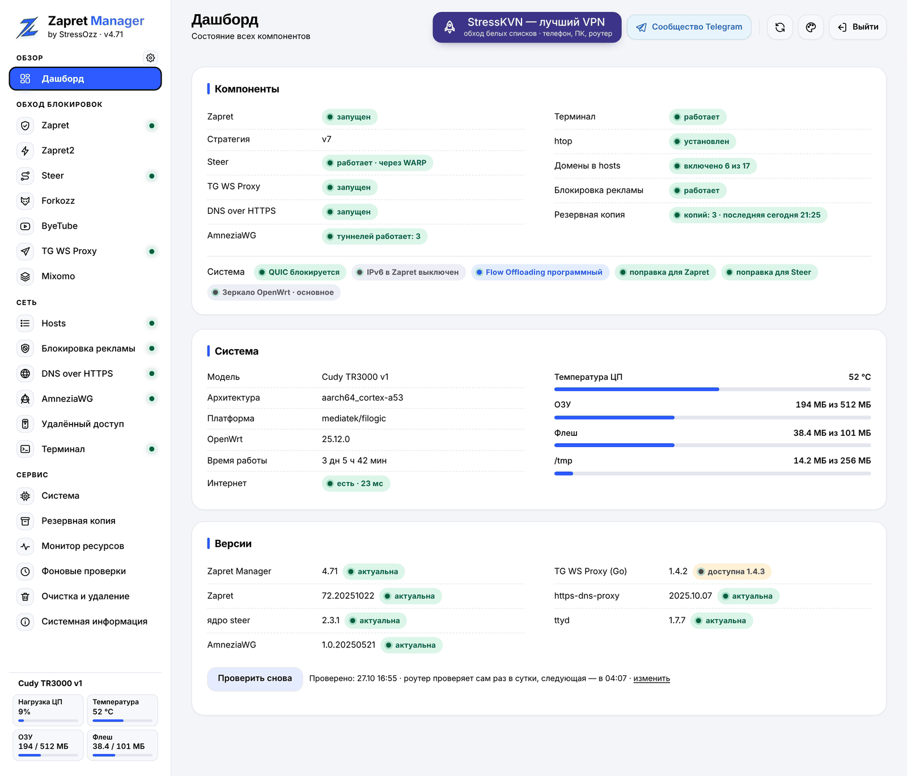</a>

<sub>Дашборд Web UI: что установлено и работает, состояние роутера, версии компонентов</sub>

**[🖼️ Скриншоты](#️-как-это-выглядит) · [💻 Установка](#-установка) · [🏁 Первые шаги](#-первые-шаги-после-установки) · [❓ Проблемы](#-частые-проблемы) · [🛠️ Для продвинутых](#️-техническая-документация-для-продвинутых)**

</div>

---

## 🙋 Что это и зачем

### Проблема

Провайдер стоит между вами и интернетом. Он видит, куда вы идёте, и может не пустить: YouTube тормозит, Discord не подключается, часть сайтов не открывается вовсе. Обычное решение — ставить VPN или специальную программу **на каждое устройство**: на телефон, на компьютер, на ноутбук. А на телевизор, приставку или игровую консоль её часто и поставить нельзя.

### Решение

Весь интернет в доме проходит через **роутер**. Значит, если научить обходить блокировки сам роутер, то обход заработает **сразу на всех устройствах** — и ничего не нужно ставить ни на телефон, ни на телевизор. Устройства даже «не знают», что что-то происходит: у них просто всё открывается.

Именно это делает **Zapret Manager**. Это программа-панель, которая:

1. **ставится на роутер** с прошивкой OpenWrt — одной командой;
2. **открывается в браузере**, как обычный сайт — с компьютера или телефона;
3. **собирает в одном месте** лучшие бесплатные инструменты обхода блокировок и позволяет поставить, настроить, проверить и удалить каждый из них кнопками — без ручного редактирования файлов и команд.

### Что вы получите

| Что | Как это выглядит для вас |
|---|---|
| ▶️ **YouTube, Discord, заблокированные сайты** | Просто открываются — на всех устройствах дома. |
| ✈️ **Telegram** | Работает стабильно, без VPN на телефоне. |
| 🚫 **Нет рекламы** | Меньше рекламы и слежки в приложениях, на сайтах и на Smart TV — сразу для всей семьи. |
| 🔐 **Защищённый DNS** | Провайдер не может подсмотреть или подменить, какие сайты вы открываете. |
| 📈 **Контроль роутера** | Видно нагрузку, температуру, память и что вообще происходит с роутером. |
| 📱 **Обход вне дома** | Телефон в мобильном интернете или чужом Wi-Fi выходит в сеть через домашний роутер — и обход работает, как дома. |
| 💾 **Резервные копии** | Сохранили настройки — «натворили дел» — вернули всё одной кнопкой. |

### Нужно ли разбираться в сетях?

**Нет.** На Windows установка — это **просто запустить файл** двойным щелчком (на других системах — вставить одну команду, ниже всё расписано). Дальше всё делается кнопками в браузере. У каждого переключателя есть подсказка «что делает и зачем». Самые важные вещи — например, подбор настроек под вашего провайдера — панель умеет делать **сама**.

### ⚡ Самый короткий путь

1. **Windows:** скачайте и запустите [`ZapretManager_Install.bat`](https://github.com/StressOzz/Zapret-Manager/releases/tag/ZapretManager_LuCI%2BWEB). Другие системы — [одна команда через SSH](#-установка).
2. Откройте в браузере **`http://192.168.1.1:7788`**, войдите с логином и паролем роутера.
3. Раздел **Zapret** → **«Установить и настроить»**. Готово.

> [!TIP]
> Если какие-то слова непонятны (DPI, VPN, DNS, прокси…) — загляните в [📚 Словарик](#-словарик). Там всё объяснено на пальцах.

---

## 🖼️ Как это выглядит

> Все скриншоты сняты с настоящего Web UI версии **4.71** (тема «Светлая», роутер Cudy TR3000). Адреса, ключи и устройства на них — демонстрационные. Нажмите на картинку, чтобы открыть её в полном размере.

<table>
  <tr>
    <td width="50%" align="center">
      <a href="docs/screenshots/login.png">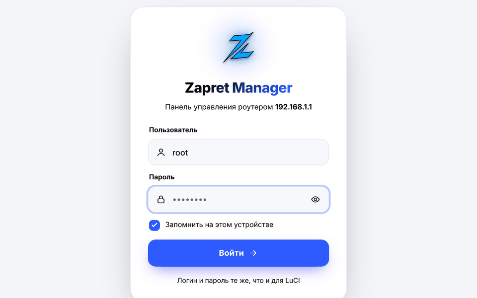</a><br>
      <sub><b>Вход</b> — логин и пароль те же, что от роутера</sub>
    </td>
    <td width="50%" align="center">
      <a href="docs/screenshots/zapret-test.png">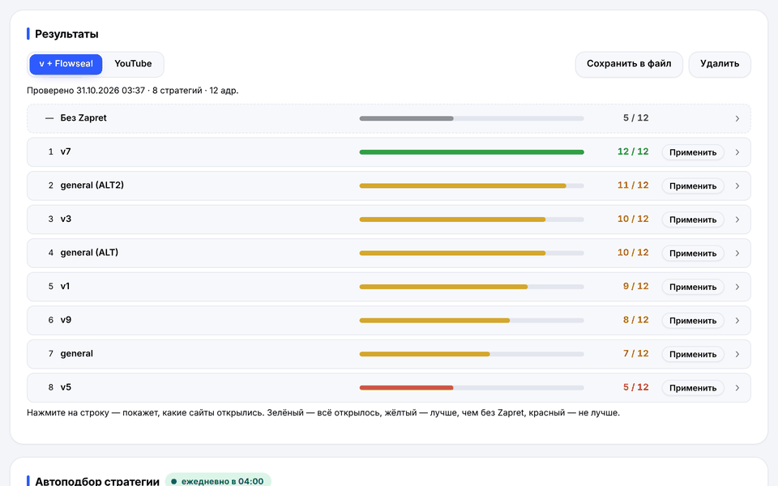</a><br>
      <sub><b>Zapret → Тест стратегий</b> — роутер сам находит лучшую стратегию</sub>
    </td>
  </tr>
  <tr>
    <td align="center">
      <a href="docs/screenshots/steer-services.png">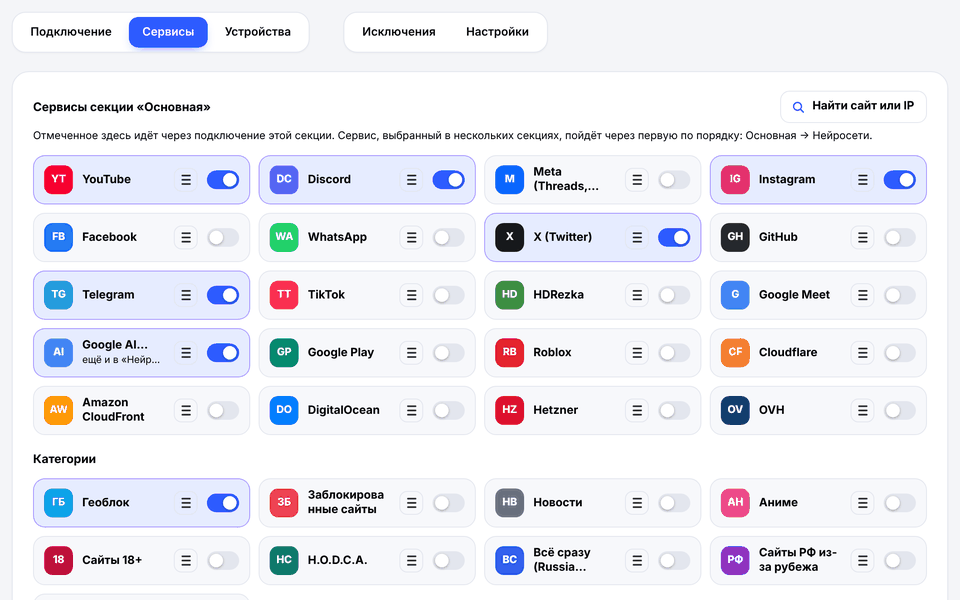</a><br>
      <sub><b>Steer</b> — галочками выбираете, что пустить через WARP или VPN</sub>
    </td>
    <td align="center">
      <a href="docs/screenshots/adblock.png">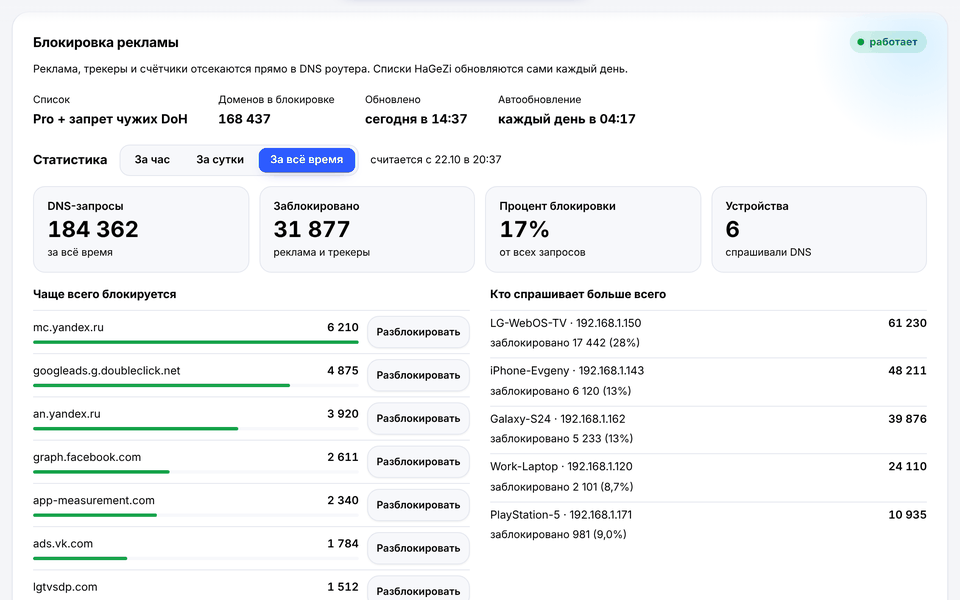</a><br>
      <sub><b>Блокировка рекламы</b> — сразу для всех устройств, со статистикой</sub>
    </td>
  </tr>
  <tr>
    <td align="center">
      <a href="docs/screenshots/tg-ws-proxy.png">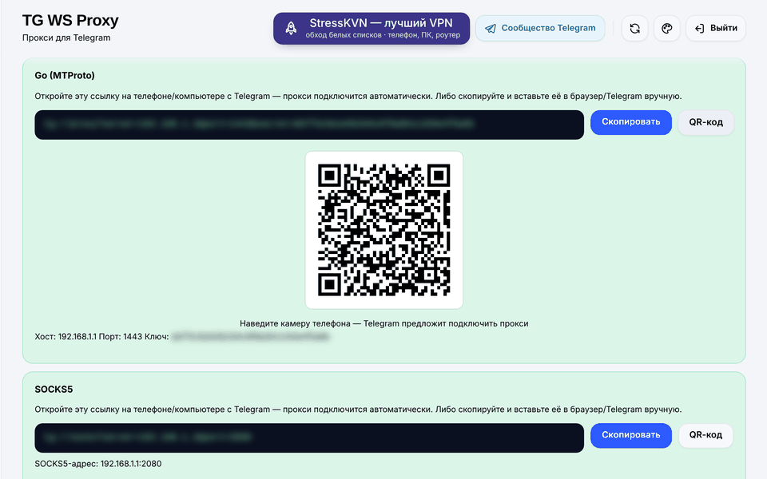</a><br>
      <sub><b>TG WS Proxy</b> — прокси для Telegram подключается по QR-коду</sub>
    </td>
    <td align="center">
      <a href="docs/screenshots/monitor.png">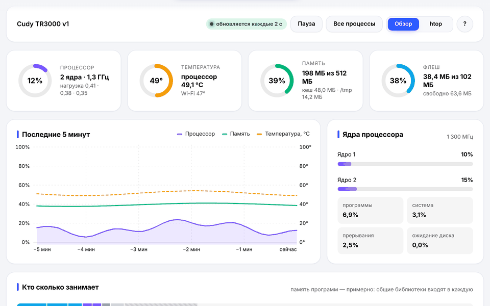</a><br>
      <sub><b>Монитор ресурсов</b> — «диспетчер задач» роутера</sub>
    </td>
  </tr>
</table>

🎨 **11 тем оформления** и 📱 **версия для телефона** — в разделе [Два интерфейса: LuCI и Web UI](#️-два-интерфейса-luci-и-web-ui). Скриншоты каждого раздела — в [Разборе разделов](#-разбор-разделов).

---

## 📖 Содержание

**Для всех:**
- [Что это и зачем](#-что-это-и-зачем)
- [Как это выглядит (скриншоты)](#️-как-это-выглядит)
- [Словарик](#-словарик)
- [Подойдёт ли мой роутер](#-подойдёт-ли-мой-роутер)
- [Установка](#-установка)
- [Первые шаги после установки](#-первые-шаги-после-установки)
- [Какой инструмент выбрать](#-какой-инструмент-выбрать)
- [Частые проблемы](#-частые-проблемы)
- [Вопросы новичков](#-вопросы-новичков)

**Подробно о каждом разделе панели:**
- [Два интерфейса: LuCI и Web UI](#️-два-интерфейса-luci-и-web-ui)
- [Разбор разделов](#-разбор-разделов)
  - [Дашборд](#-дашборд)
  - [Zapret](#️-zapret)
  - [Zapret2](#-zapret2)
  - [Steer](#️-steer)
  - [Forkozz](#-forkozz)
  - [ByeTube](#️-byetube)
  - [TG WS Proxy](#-tg-ws-proxy)
  - [Mixomo](#-mixomo)
  - [Hosts](#-hosts)
  - [Блокировка рекламы](#-блокировка-рекламы)
  - [DNS over HTTPS](#-dns-over-https)
  - [AmneziaWG](#-amneziawg)
  - [Удалённый доступ (Tailscale)](#-удалённый-доступ-tailscale)
  - [Терминал](#-терминал)
  - [Монитор ресурсов](#-монитор-ресурсов)
  - [Система](#️-система)

**Для любопытных и продвинутых:**
- [Совместимость компонентов](#-совместимость-компонентов)
- [Техническая документация](#️-техническая-документация-для-продвинутых)
  - [Архитектура](#архитектура)
  - [Web UI изнутри](#web-ui-изнутри)
  - [API: объект ubus `zapret-manager`](#api-объект-ubus-zapret-manager)
  - [Фоновые задания](#фоновые-задания)
  - [Расписания (cron)](#расписания-cron)
  - [Файлы и каталоги](#файлы-и-каталоги)
  - [Обновление панели](#обновление-панели)
  - [Формат резервной копии `.zmb`](#формат-резервной-копии-zmb)
  - [Безопасность](#безопасность)
  - [Диагностика из SSH](#диагностика-из-ssh)
- [Удаление](#️-удаление)
- [Благодарности](#-благодарности)

> **Как читать разделы.** У каждого раздела сначала идёт объяснение **простыми словами**, а потом подробности. У каждой функции указано, **что она делает** и *зачем это нужно*. Подробности можно пропускать — для обычной работы хватает первых абзацев.

---

## 📚 Словарик

Короткие объяснения слов, которые встречаются в панели и в этом описании.

| Слово | Простыми словами |
|---|---|
| **Роутер** | Коробочка, которая раздаёт интернет по Wi-Fi и проводам. Через неё проходит весь трафик дома. |
| **OpenWrt** | «Операционная система» для роутера — как Windows для компьютера, только открытая и с большими возможностями. Её ставят вместо заводской прошивки. Zapret Manager работает только на ней. |
| **LuCI** | Стандартная веб-страница настроек OpenWrt (обычно `http://192.168.1.1`). Zapret Manager добавляет туда свой пункт меню. |
| **Web UI** | Отдельная, более удобная страница панели Zapret Manager на порту **7788** (`http://192.168.1.1:7788`). Делает то же, что и пункт в LuCI. |
| **SSH** | Способ «зайти внутрь» роутера и набирать команды, как в командной строке. Нужен только один раз — для установки. |
| **IP-адрес роутера** | Адрес, по которому роутер открывается в браузере. Чаще всего `192.168.1.1`. |
| **DPI** | «Фильтр» у провайдера, который смотрит на ваш трафик и решает, пропустить его или заблокировать. |
| **Обход DPI** | Хитрость: пакеты немного «переодеваются», и фильтр не узнаёт, на какой сайт вы идёте. Сайт открывается напрямую, без чужих серверов. Так работают **Zapret**, **Zapret2** и **ByeTube**. |
| **Стратегия** | Набор таких «переодеваний». У каждого провайдера фильтр свой, поэтому и подходят разные стратегии. Панель умеет сама подобрать лучшую. |
| **VPN / туннель** | Трафик заворачивается в защищённую «трубу» и выходит в интернет в другом месте (часто — в другой стране). Провайдер видит только трубу, но не то, что внутри. |
| **WARP** | Бесплатный туннель от компании Cloudflare. Панель умеет настраивать его сама — ничего покупать не нужно. |
| **Подписка** | Ссылка от платного VPN-сервиса, в которой лежит список его серверов. Вставляете ссылку — панель сама берёт оттуда серверы. |
| **Прокси** | Посредник: приложение (например, Telegram) отправляет трафик не напрямую, а через него. |
| **Раздельная маршрутизация** | Через туннель идут **только выбранные сайты** (например, YouTube и Instagram), а всё остальное — напрямую. Интернет не замедляется, а российские сайты и банки работают как обычно. Так работают **Steer**, **Forkozz**, **Mixomo**. |
| **DNS** | «Телефонная книга» интернета: превращает имя сайта (`youtube.com`) в его адрес (цифры). Провайдер может подменять ответы — это один из способов блокировки. |
| **DoH (DNS over HTTPS)** | Та же «телефонная книга», но запросы зашифрованы — провайдер не может их подсмотреть или подменить. |
| **hosts** | Файл на роутере, где можно вручную записать: «этот сайт находится по такому-то адресу». Помогает, когда сайт блокируют именно через DNS. |
| **Флеш / ОЗУ** | Флеш — «жёсткий диск» роутера (там хранятся программы). ОЗУ — оперативная память (там программы работают). У роутеров их мало, поэтому панель следит за местом. |
| **Архитектура** | Тип процессора роутера (например, `aarch64_cortex-a53`). От неё зависит, какие версии программ подходят. Панель определяет её сама. |
| **Пакет** | Программа для роутера, которую можно поставить или удалить. Панель ставит нужные пакеты сама. |
| **Секция** | В Steer и Forkozz — отдельный «маршрут»: свой набор сервисов и своё подключение. Например, видео — через VPN, нейросети — через WARP. |
| **Точка входа** | Адрес сервера Cloudflare, к которому подключается туннель WARP. У разных провайдеров работают разные — панель подбирает сама. |
| **Tailscale** | Программа, которая соединяет ваш телефон с домашним роутером через интернет, где бы вы ни были. Нужна для «Удалённого доступа». |
| **Exit Node (выходной узел)** | Устройство, через которое другое устройство выходит в интернет. В «Удалённом доступе» это ваш роутер. |
| **Резервная копия** | Снимок всех настроек панели. Из него можно вернуть всё как было. |

---

## ✅ Подойдёт ли мой роутер

**Коротко:** если на роутере стоит свежий **OpenWrt (24.10 или новее)** — почти наверняка подойдёт.

| Что нужно | Зачем | Как проверить |
|---|---|---|
| **OpenWrt** с **firewall4 / nftables** | Все правила обхода написаны под этот «файрвол». Он стоит по умолчанию в OpenWrt 22.03 и новее. | В LuCI: **Состояние → Обзор**, строка «Версия прошивки». |
| **opkg** (24.10 и старше) или **apk** (25.12 и новее) | Панель умеет работать с обоими «магазинами программ» — подходят обе ветки OpenWrt. | Ничего делать не нужно — панель определит сама. |
| OpenWrt **24.10+** | Нужен для Forkozz и ByeTube: им нужна программа `hev-socks5-tunnel` из стандартных репозиториев. | Там же — «Версия прошивки». |
| ~**15 МБ** свободного флеша | Для Forkozz + sing-box. Расширенный sing-box — около 40 МБ. Сам Zapret и панель занимают меньше. | В LuCI: **Система → Программное обеспечение** или на Дашборде панели после установки. |
| ~**60 МБ** свободной ОЗУ | Для блокировки рекламы: список хранится в памяти. Остальному хватит и меньше. | В LuCI: **Состояние → Обзор**, «Память». |
| **aarch64_cortex-a53** | Только для **Zapret2**: его пакеты собраны под этот процессор. Остальное работает на любых. | Дашборд панели покажет архитектуру. |
| Свободный флеш для **Tailscale** | Только для **Удалённого доступа**. Сколько нужно — панель покажет перед установкой. | Страница «Удалённый доступ». |
| Пакет `ip-full` | Только для **ByeTube**. | Панель подскажет, если его нет. |

> [!NOTE]
> Не уверены? Просто установите панель — это безопасно. Дашборд сразу покажет модель, архитектуру, версию OpenWrt, свободную память и флеш. Если какой-то компонент не подходит вашему роутеру, панель **не даст его поставить** и объяснит почему.

---

## 💻 Установка

Установка делается **один раз** и занимает пару минут. Дальше всё — в браузере. Есть два способа — выберите любой.

**Перед началом проверьте:**

- [ ] на роутере стоит **OpenWrt** (см. [Подойдёт ли мой роутер](#-подойдёт-ли-мой-роутер));
- [ ] вы знаете **пароль роутера** — тот, с которым входите в LuCI (если пароля нет, задайте его в LuCI: **Система → Администрирование**);
- [ ] компьютер или телефон подключён **к этому роутеру** — по Wi-Fi или кабелю, **VPN на нём выключен**;
- [ ] на самом роутере **есть интернет** — установщик скачивает файлы с GitHub.

### 🟢 Способ 1. Для Windows — просто запустите файл (самый простой)

Ничего вводить не нужно — ни команд, ни программ вроде PuTTY.

1. Скачайте **`ZapretManager_Install.bat`** со страницы релиза:
   👉 **[Скачать установщик для Windows](https://github.com/StressOzz/Zapret-Manager/releases/tag/ZapretManager_LuCI%2BWEB)** (раздел **Assets** внизу страницы).
2. Компьютер должен быть подключён к роутеру (по Wi-Fi или кабелю).
3. **Дважды щёлкните** по скачанному файлу.
4. Установщик **сам найдёт роутер** в сети (или спросит его адрес), подключится к нему, а если на роутере стоит пароль — попросит его ввести (при вводе он не виден — это нормально).
5. Дальше роутер сам скачает и поставит последнюю версию Zapret Manager — ход установки видно в окне. В конце будет адрес панели — переходите к [Шагу 4](#шаг-4-откройте-панель).

Работает на Windows 10 и 11. Всё в одном файле, после работы установщик сам убирает за собой временные файлы.

> [!WARNING]
> **Антивирус или Windows может ругаться — это ложная тревога.**
>
> Внутри `.bat` спрятана маленькая программа для подключения к роутеру (`plink` из известного пакета PuTTY), и установщик её распаковывает и подключается по сети. Антивирусы не любят, когда скрипт так делает, поэтому могут предупредить, даже если вирусов нет. **Вирусов в файле нет**: это обычный текстовый скрипт — его можно открыть Блокнотом и посмотреть, что внутри.
>
> Что может появиться и что нажать:
> - **браузер** пишет «файл обычно не скачивают» → **«Сохранить»** / **«Всё равно сохранить»**;
> - синее окно **«Windows защитила ваш компьютер»** → **«Подробнее»** → **«Выполнить в любом случае»**;
> - **антивирус** удалил файл → добавьте его в исключения или ненадолго приостановите защиту на время установки.
>
> Скачивайте установщик **только со страницы релиза в этом репозитории** — не с чужих сайтов и не из пересланных файлов.

### ⌨️ Способ 2. Через SSH (Windows, macOS, Linux, телефон)

Подходит для любой системы и для тех, кто привык к командной строке.

#### Шаг 1. Узнайте адрес роутера

Чаще всего это **`192.168.1.1`**. Если не открывается — посмотрите адрес «шлюза» на компьютере или телефоне в настройках подключения к Wi-Fi.

#### Шаг 2. Подключитесь к роутеру по SSH

SSH — это «командная строка роутера». Логин всегда **`root`**, пароль — **тот же, что от LuCI** (страницы настроек роутера).

<details>
<summary><b>🪟 Windows 10 / 11</b></summary>

1. Нажмите правой кнопкой мыши на **Пуск** → **Терминал** (или **Windows PowerShell**).
2. Введите и нажмите **Enter**:
   ```
   ssh root@192.168.1.1
   ```
3. При первом подключении спросит `Are you sure you want to continue connecting?` — напишите **`yes`** и нажмите Enter.
4. Введите пароль роутера и нажмите Enter.

> ⚠️ Пароль при вводе **не отображается** — ни звёздочек, ни точек. Это нормально: просто наберите его и нажмите Enter.

</details>

<details>
<summary><b>🍏 macOS и 🐧 Linux</b></summary>

Откройте программу **Терминал** и введите:

```sh
ssh root@192.168.1.1
```

Дальше так же: `yes` при первом подключении и пароль роутера (он не отображается при вводе).

</details>

<details>
<summary><b>📱 Android / iPhone</b></summary>

Поставьте любой SSH-клиент (например, **Termius**), создайте подключение: адрес `192.168.1.1`, порт `22`, пользователь `root`, пароль — от роутера.

</details>

Если всё получилось, вы увидите приветствие OpenWrt и строку вида `root@OpenWrt:~#`.

#### Шаг 3. Вставьте команду установки

Скопируйте эту строку, вставьте в окно SSH (в Windows-терминале — **правой кнопкой мыши** или `Ctrl+V`) и нажмите **Enter**:

```sh
sh <(wget -qO - https://raw.githubusercontent.com/StressOzz/Zapret-Manager/refs/heads/main/ZapretManager_LuCI.sh)
```

Установщик всё сделает сам и будет писать по-русски, что происходит. Зелёные галочки `✓` — шаг выполнен, жёлтые `!` — предупреждение (обычно не страшно, там написано, что делать).

*Зачем вообще SSH:* установщику нужно записать файлы в систему роутера и настроить службы — через браузер это сделать нельзя. Нужно это только один раз: обновления потом ставятся кнопкой в панели.

### Шаг 4. Откройте панель

*(одинаково для обоих способов)*

В конце установщик напишет:

```
Готово: Zapret Manager для LuCI и Web … установлен

LuCI:   Службы → Zapret Manager
Web UI: http://192.168.1.1:7788
```

Откройте адрес **Web UI** в браузере и войдите с **тем же логином и паролем, что от роутера** (`root` и ваш пароль). Всё — панель готова. Теперь переходите к разделу [🏁 Первые шаги после установки](#-первые-шаги-после-установки).

<p align="center">
  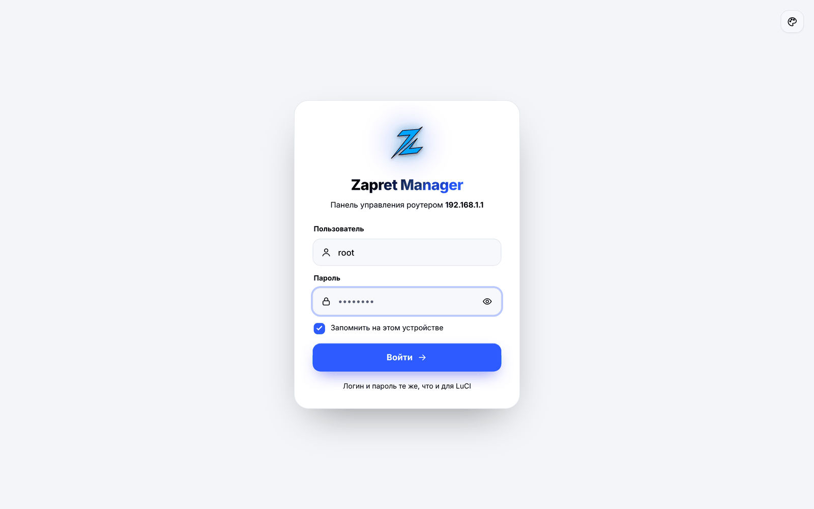<br>
  <sub>Экран входа. Галочка «Запомнить на этом устройстве» — чтобы не вводить пароль каждый раз.</sub>
</p>

> [!NOTE]
> **Не открывается `192.168.1.1:7788`?** Подставьте адрес вашего роутера — установщик пишет его в последней строке (`Web UI: http://…`). Панель открывается **только из домашней сети**: с мобильного интернета или через VPN на телефоне не откроется. Если не помогло — см. [«Web UI не открывается на порту 7788»](#-частые-проблемы).

> [!TIP]
> **Сохраните адрес панели в закладки** (`http://192.168.1.1:7788`). На телефоне его удобно добавить на главный экран: в браузере меню → «Добавить на главный экран» — панель будет открываться как приложение.
>
> Компьютер после установки можно выключать: всё работает **на самом роутере**, в том числе после его перезагрузки.

> [!IMPORTANT]
> **Для некоторых стратегий Zapret на компьютере нужно один раз включить TCP timestamps.** Такие стратегии используют «метки времени» в пакетах; если на компьютере они выключены, стратегия не сработает. Телефонам и ТВ это не нужно.
>
> Windows — откройте **Терминал от имени администратора** и выполните:
> ```
> netsh int tcp set global timestamps=enabled
> ```
>
> Linux:
> ```
> sysctl -w net.ipv4.tcp_timestamps=1
> ```

### Что делает установщик (для любопытных)

| Шаг | Что происходит | Зачем |
|---|---|---|
| 1. Проверка | Если панель уже стояла и в ней идёт операция (установка, тест…), установщик попросит дождаться её окончания. | Чтобы не заменить файлы посреди работы и ничего не сломать. |
| 2. Копирование файлов | Ставятся бэкенд, rpcd-плагин, права доступа (ACL), пункт меню LuCI и страницы. | Бэкенд выполняет всю работу. rpcd-плагин и ACL дают браузеру безопасный доступ к нему. Меню и страницы — это то, что вы видите. |
| 3. Пакеты `curl`, `unzip`, `uhttpd-mod-ubus` | Докачиваются, если их нет. | `curl` скачивает файлы, `unzip` проверяет архивы, `uhttpd-mod-ubus` нужен для Web UI. |
| 4. Web UI на порту **7788** | Поднимается отдельный экземпляр веб-сервера `uhttpd`. | Web UI работает независимо от LuCI и не мешает ему. |
| 5. Сторож и команды | В cron добавляется «сторож» (раз в 2 минуты), в систему — команды `zms` и `zmw`. | Сторож сам чинит упавшее. Команды — быстрый запуск из SSH. |
| 6. Уборка | Удаляются временные файлы и остатки прошлых версий; показывается, сколько места освобождено и сколько занимает панель. | Флеш у роутера маленький — лишнее не должно копиться. |

### Обновление

Обновлять вручную не нужно. Панель **сама проверяет**, вышла ли новая версия, и показывает баннер на Дашборде. Нажмите **«Обновить панель»** — она скачает установщик, проверит, что файл скачался целиком и без ошибок, и только потом установит. Перед обновлением панель покажет окно **«Что изменится»**, а после — **«Что нового»** со списком изменений. **Настройки всех компонентов при обновлении сохраняются**, и на всякий случай панель сама делает [резервную копию](#-резервная-копия-панели).

### Полезные команды в SSH

| Команда | Что делает |
|---|---|
| **`zmw`** | Переустанавливает / обновляет эту панель (LuCI + Web UI) — та же команда установки, только короче. |
| **`zms`** | Запускает консольную версию [Zapret-Manager.sh](https://github.com/StressOzz/Zapret-Manager) прямо в терминале — удобно, когда браузер не нужен. |

> [!NOTE]
> Нужна только версия **для SSH**, без веб-панели? Описание — [**readme_ssh.md**](https://github.com/StressOzz/Zapret-Manager/blob/main/readme_ssh.md), установка:
> ```
> sh <(wget -qO - 'https://raw.githubusercontent.com/StressOzz/Zapret-Manager/main/Zapret-Manager.sh')
> ```

---

## 🏁 Первые шаги после установки

Пошаговый сценарий для тех, кто открыл панель впервые и не знает, с чего начать.

**1. Посмотрите на Дашборд.** Это главная страница. Там видно, что уже стоит, есть ли интернет, не перегружен ли роутер. Если вверху есть жёлтые баннеры-подсказки (например, «Включён Flow Offloading, а FIX не применён») — нажмите в них **«Применить»**: панель сама нашла, что мешает обходу, и знает, как это исправить.

**2. Поставьте Zapret.** Откройте раздел **Zapret** → нажмите **«Установить и настроить»**. Панель скачает Zapret, поставит его и сразу применит проверенные настройки — для сайтов, для YouTube, для игр. Подождите, пока в окне вывода появится «готово».

**3. Проверьте.** Откройте на компьютере или телефоне YouTube, Discord, заблокированные сайты. У многих на этом всё — **дальше можно ничего не делать**.

**4. Если что-то не открывается — запустите подбор.** В Zapret откройте вкладку **«Тест стратегий»** и запустите тест. Роутер сам переберёт все стратегии и покажет, какая открывает больше всего сайтов **именно у вашего провайдера**. Нажмите **«Применить»** у лучшей. Отдельно можно подобрать стратегию для YouTube.

**5. Включите автоподбор (по желанию).** Провайдеры иногда меняют фильтры, и стратегия, которая работала вчера, может перестать работать. **Автоподбор по расписанию** каждую ночь сам проверит и, если найдёт стратегию лучше, — поставит её. Вам ничего делать не нужно.

**6. Если какой-то сайт не открывается вообще ничем** — значит, его блокируют так, что «переодевание» не помогает (например, по адресу или из-за того, что сам сайт не пускает пользователей из России). Тогда нужен туннель: поставьте **Steer** — он бесплатно и автоматически настроит WARP и пустит через него **только нужные сервисы**. Подробнее — в таблице [🧭 Какой инструмент выбрать](#-какой-инструмент-выбрать).

**7. Сделайте резервную копию.** Когда всё заработало, откройте **Система → Резервная копия панели** → **«Создать копию»**. Если потом что-то испортите — нажмёте «Восстановить», и всё вернётся как было. Панель и сама делает копию перед установкой, удалением и обновлением.

**8. Дополнительно — по желанию:**
- **TG WS Proxy** — если плохо работает Telegram;
- **Блокировка рекламы** — убрать рекламу на всех устройствах;
- **DNS over HTTPS** — защитить DNS от подмены;
- **Удалённый доступ** — чтобы обход работал на телефоне и вне дома (для опытных);
- **Монитор ресурсов** — посмотреть, как себя чувствует роутер.

> [!TIP]
> **Ничего не бойтесь сломать.** Любой компонент можно остановить или полностью удалить одной кнопкой — после удаления не остаётся «мусора». Если что-то пошло не так, нажмите «Остановить» у последнего, что вы поставили, и проверьте, вернулся ли интернет.

---

## 🖥️ Два интерфейса: LuCI и Web UI

**Простыми словами:** одну и ту же панель можно открыть двумя способами. Выбирайте, какой удобнее, — умеют они одно и то же.

### LuCI

Пункт меню **Службы → Zapret Manager** в стандартной странице настроек роутера, 16 страниц: Дашборд, Zapret, Zapret2, Steer, Forkozz, Hosts, Блокировка рекламы, DNS over HTTPS, AmneziaWG, Удалённый доступ, Терминал, TG WS Proxy, Mixomo, ByeTube, Система, Монитор ресурсов.

*Зачем:* привычное место — вход тот же, что и в остальные настройки роутера.

### Web UI на порту 7788

Отдельная, более современная панель — `http://адрес-роутера:7788`:

- 🔑 **вход по логину и паролю роутера** с флажком «Запомнить на этом устройстве». *Зачем:* отдельные пароли не нужны, а посторонний без пароля роутера внутрь не попадёт.
- 🎨 **11 тем оформления**: Светлая, Лёгкая, Тёмная, Контур, Бенто, Минимал, Ретро 98, Объём 3D, Графит, OLED, Матрица — или **«Авто»** (светлая днём, тёмная — если тёмная тема включена в системе). Выбранная тема сохраняется **на роутере**. *Зачем:* тема подхватывается на любом устройстве, настраивать заново не надо.
- 📱 **удобно с телефона**: меню выезжает сбоку, всё подстраивается под маленький экран.
- 🗂 **«Настроить меню»** — спрячьте разделы, которыми не пользуетесь (кнопка «Скрыть неустановленные» убирает всё, что не стоит). Меню сохраняется на роутере. *Зачем:* в меню остаётся только нужное, проще ориентироваться.
- ⚙️ **раздел «Система» разбит на подразделы** прямо в меню: параметры роутера, фоновые проверки, очистка и удаление, системная информация, резервная копия.
- 🟢 **цветные точки у разделов**: зелёная — работает, жёлтая — работает частично, красная — не работает. *Зачем:* состояние всего видно, не открывая разделы.
- 📊 **в боковой панели** — модель роутера, версия OpenWrt, температура и нагрузка процессора, память, флеш. *Зачем:* сразу видно, не перегружен ли роутер.
- 🔒 **открывается только из домашней сети** — из интернета до неё не достучаться. Если сессия истекла, панель сама попросит войти снова.

Страницы LuCI и Web UI — один и тот же код: Web UI загружает те же модули и подменяет только «обвязку» LuCI. Что умеет одна, то умеет и другая.

<p align="center">
  <a href="docs/screenshots/themes.png">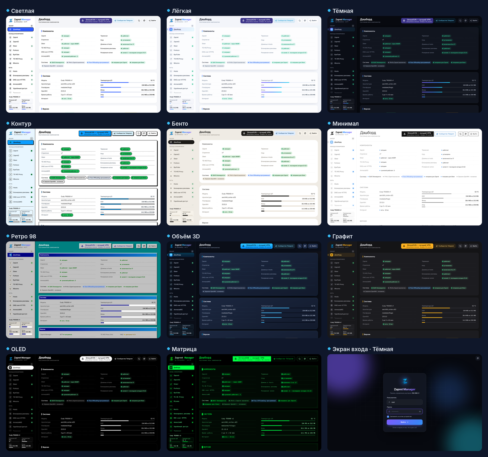</a><br>
  <sub>Один и тот же Дашборд во всех 11 темах. Последняя картинка — экран входа в тёмной теме.</sub>
</p>

<p align="center">
  <a href="docs/screenshots/mobile.png">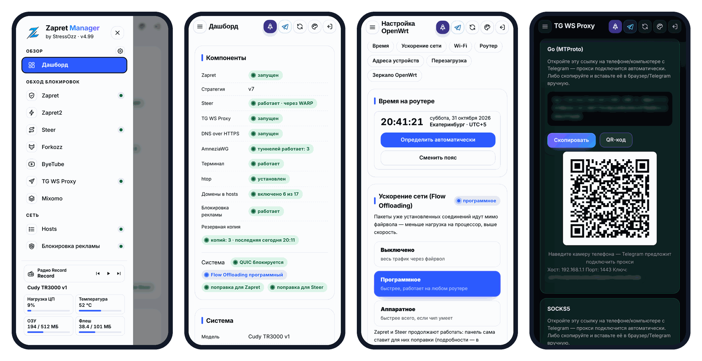</a><br>
  <sub>Web UI на телефоне: меню, Дашборд, Steer и TG WS Proxy с QR-кодом.</sub>
</p>

<details>
<summary><b>Как устроено меню Web UI (все разделы)</b></summary>

| Группа | Разделы |
|---|---|
| **Обзор** | Дашборд |
| **Обход блокировок** | Zapret · Zapret2 · Steer · Forkozz · ByeTube · TG WS Proxy · Mixomo |
| **Сеть** | Hosts · Блокировка рекламы · DNS over HTTPS · AmneziaWG · Удалённый доступ · Терминал |
| **Сервис** | Система · Резервная копия · Монитор ресурсов · Фоновые проверки · Очистка и удаление · Системная информация |

Шестерёнка рядом с «Обзор» — **«Настроить меню»**: лишние разделы можно скрыть. Внизу боковой панели — модель роутера и четыре мини-шкалы: нагрузка процессора, температура, ОЗУ и флеш. Вверху справа: **StressKVN**, ссылка на **сообщество в Telegram**, ⟳ «обновить страницу», 🎨 «тема» и «Выйти».

</details>

---

## 🧩 Разбор разделов

### 📊 Дашборд

> **Простыми словами:** главная страница — «приборная панель» роутера. За минуту понятно, что работает, что сломалось и что пора обновить.

<p align="center">
  <a href="docs/screenshots/dashboard.png"></a><br>
  <sub>Карточки «Компоненты», «Система» и «Версии». Зелёная точка у пункта меню — компонент работает.</sub>
</p>

**Как читать цветные метки** (они одинаковые во всей панели):

| Метка | Что значит |
|---|---|
| 🟢 зелёная — «запущен», «работает», «актуальна» | всё в порядке |
| 🟡 жёлтая — «доступна 1.4.3», «работает частично» | не авария, но стоит заглянуть: вышла новая версия или часть функций не работает |
| 🔴 красная — «не работает», «нет поправки» | что-то сломалось — откройте раздел, там будет подсказка и кнопка |
| ⚪ серая — «выключен», «не проверялась» | функция выключена вами или ещё не настроена |
| 🔵 синяя — «Flow Offloading программный» | просто информация |

- **Компоненты** — статус каждого инструмента: Zapret, Zapret2, Steer (и через что идут сервисы — WARP, свой WARP, VPN или интерфейс AmneziaWG), Forkozz, ByeTube, TG WS Proxy, Mixomo, DoH, AmneziaWG (сколько туннелей работает), **Удалённый доступ** (подключён ли роутер к Tailscale), домены в hosts, блокировка рекламы, терминал, **резервная копия** (когда сделана последняя).
- **Система** — модель, архитектура, платформа, версия OpenWrt, время работы, есть ли интернет и с какой задержкой (пинг `ya.ru` / `vk.ru`), шкалы температуры и нагрузки процессора, памяти, флеша и `/tmp`. Обновляются каждые 5 секунд. *Зачем:* если роутер перегрет или кончается память, это видно сразу.
- **Версии** — установленная и последняя версия каждой программы: Zapret Manager, Zapret, Mihomo, MagiTrickle, hev-socks5-tunnel, TG WS Proxy, sTGWS, ядро steer, Forkozz, sing-box, Zapret2, ByeDPI, AmneziaWG, https-dns-proxy, Tailscale. *Зачем:* видно, что устарело и что можно обновить. Как часто искать новые версии, выбирается в **Система → Поиск новых версий**: раз в сутки ночью (по умолчанию — Дашборд тогда открывается быстро и в интернет не ходит), при каждом открытии Дашборда или только кнопкой «Проверить».
- **Предупреждение «DNS не работает»** — если сайты по IP-адресу отвечают, а имена сайтов роутер найти не может, панель скажет об этом прямо и подскажет, что делать (обычно — сменить сервер в DNS over HTTPS). *Зачем:* в такой ситуации «вроде интернет есть, а ничего не открывается» — и сразу непонятно почему.
- **Подсказки-баннеры** с кнопкой «Применить» — панель сама находит типичные проблемы:
  - «Включён Flow Offloading, а FIX не применён» — функция ускорения роутера пропускает пакеты мимо обхода; фикс это исправляет;
  - «Роутер работает по IPv6, а в Zapret IPv6 выключен» — иначе часть трафика пойдёт мимо обхода;
  - «Желательно перезагрузить роутер» — после удаления компонентов, чтобы очистить остатки правил.

---

### 🛡️ Zapret

> **Простыми словами:** главный и самый популярный инструмент. Он немного «переодевает» ваш трафик, и фильтр провайдера перестаёт узнавать заблокированные сайты. Сайты открываются **напрямую**, без чужих серверов и подписок — поэтому бесплатно и без потери скорости.
>
> **Кому нужен:** почти всем. Начинайте с него.

Основан на [zapret-openwrt](https://github.com/remittor/zapret-openwrt). Самый большой раздел — 7 вкладок: **Стратегии**, **Тест стратегий**, **YouTube**, **Игры**, **Discord**, **Редактор списков**, **Исключение устройств**.

<p align="center">
  <a href="docs/screenshots/zapret-strategies.png">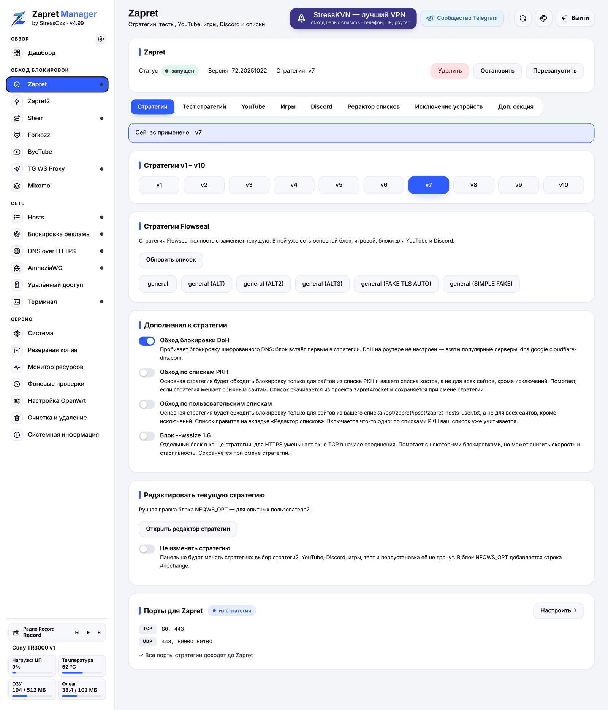</a><br>
  <sub>Вкладка «Стратегии»: статус Zapret, выбор стратегии одним нажатием, дополнения и редактор.</sub>
</p>

<details>
<summary><b>Установка и управление</b></summary>

- **Установить и настроить** — один клик, и всё готово: скачивает последнюю версию под ваш роутер (до 5 попыток, с проверкой архива), ставит, загружает список исключений и дополнительные файлы, затем применяет базовую стратегию **v7**, игровую **Gv1** и полезные записи в hosts. *Зачем:* работает «из коробки»; повторы и проверка — чтобы обрыв загрузки не оставил сломанную установку.
- **Обновить до …** — кнопка появляется, если вышла новая версия. *Зачем:* обновление в один клик.
- **Запустить / Остановить / Удалить** — удаление полное: пакеты, папка `/opt/zapret`, настройки, задания по расписанию, правила файрвола. *Зачем:* не остаётся мусора, который мог бы мешать.
- Если GitHub недоступен и последнюю версию узнать не удалось — ставится проверенная фиксированная. *Зачем:* установка не срывается.

</details>

<details>
<summary><b>Стратегии</b></summary>

*Стратегия* — набор приёмов, которыми Zapret обманывает фильтр провайдера. У разных провайдеров работают разные, поэтому их несколько.

- **v1 – v10** — десять встроенных стратегий. *Зачем:* если одна не помогает у вашего провайдера, можно попробовать другую (а лучше — запустить тест, он переберёт сам).
- **Flowseal** — стратегии из популярного проекта [zapret-discord-youtube](https://github.com/Flowseal/zapret-discord-youtube) для Windows. Панель скачивает их и сама переделывает под роутер. *Зачем:* проверенные стратегии без ручной переделки.
- При смене стратегии **сохраняются** настройки YouTube, Discord, игр, QUIC и дополнения. *Зачем:* меняя основную стратегию, не нужно заново настраивать остальное.
- **Дополнения к стратегии:**
  - **Обход по спискам РКН** — обход работает только для сайтов из списка заблокированных ([zapret4rocket](https://github.com/IndeecFOX/zapret4rocket)) и вашего списка, а не «для всего, кроме исключений». *Зачем:* если стратегия ломает обычные сайты.
  - **Блок `--wssize 1:6`** — ещё один приём. *Зачем:* некоторым провайдерам помогает именно он.
  - **Обход блокировки DoH** — некоторые провайдеры обрывают соединения с серверами шифрованного DNS. Этот блок «пробивает» такую блокировку: он встаёт первым в стратегии, а список серверов берётся из настроек DNS over HTTPS роутера и меняется вместе с ними (если DoH не настроен — берутся популярные серверы). *Зачем:* чтобы DNS over HTTPS работал даже там, где провайдер его режет. Раздел DoH сам подскажет включить этот блок, если увидит обрыв.
- **Flowseal загружается по кнопке** «Загрузить список» — скачивается с GitHub только когда нужен. Пока он грузится, можно выбирать другие стратегии.
- **Редактор текущей стратегии** — ручная правка для опытных, с проверкой: заведомо нерабочую строку сохранить не даст.
- **«Не изменять стратегию»** — панель больше не трогает стратегию: ни при выборе, ни в тестах, ни при переустановке. *Зачем:* если вы всё настроили вручную и не хотите, чтобы что-то перезаписалось.

</details>

<details>
<summary><b>Тест стратегий и автоподбор</b></summary>

> **Простыми словами:** вместо того чтобы перебирать стратегии вручную, нажмите одну кнопку — роутер сам проверит все и покажет, какая лучше всего работает у вашего провайдера.

Тест идёт в фоне — вкладку можно закрыть. После теста настройки Zapret возвращаются как были, пока вы сами не нажмёте «Применить».

<p align="center">
  <a href="docs/screenshots/zapret-test.png">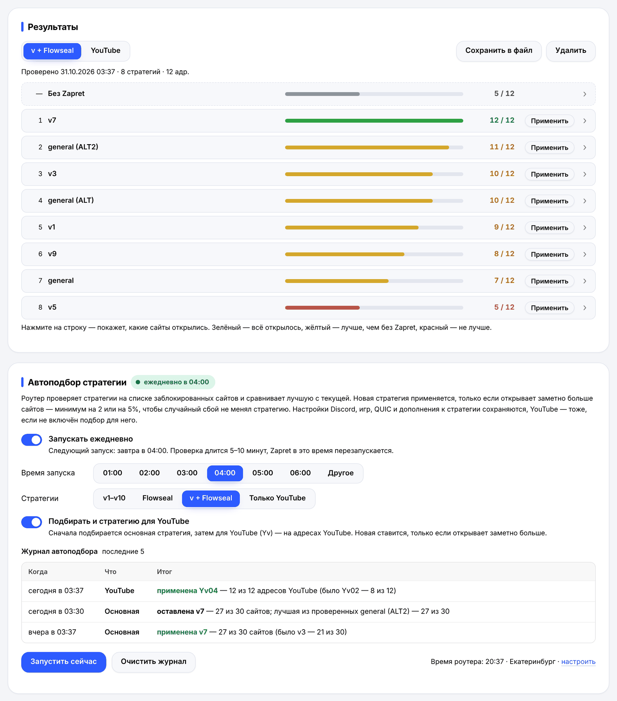</a><br>
  <sub>Результаты теста (сверху — «Без Zapret» для сравнения) и автоподбор по расписанию с журналом.</sub>
</p>

**Как прочитать результат:** строка «Без Zapret» — сколько сайтов открывается вообще без обхода (на скриншоте 5 из 12). Всё, что ниже, — стратегии от лучшей к худшей. `12 / 12` и зелёная полоса — открылось всё; жёлтая — лучше, чем без Zapret; красная — пользы нет. Нажмите на строку, чтобы увидеть, какие именно сайты не открылись, и **«Применить»** у лучшей.

| Режим | Что делает |
|---|---|
| **Текущая стратегия** | Проверяет то, что стоит сейчас, ничего не меняя. |
| **По домену** | Проверяет все стратегии на ваших сайтах (до 30). Нужно, когда важен конкретный сайт. |
| **v1–v10 / Flowseal / v + Flowseal** | Перебор стратегий по списку заблокированных сайтов. |
| **YouTube** | Перебор стратегий для YouTube. |
| **Свои стратегии** | Ваш собственный список (`/root/custom_test.txt`, тот же формат, что в консольной версии). |

- Сначала делается **замер без Zapret**, затем каждая стратегия. *Зачем:* чтобы честно видеть пользу — «лучше, чем без Zapret».
- Проверяются: госуслуги, налоговая, rutube, торрент-трекеры, Discord, X, Instagram, GitHub и набор из [dpi-checkers](https://github.com/hyperion-cs/dpi-checkers).
- Результаты отсортированы: сверху лучшие. Цвет: 🟢 открылось всё, 🟡 лучше, чем без Zapret, 🔴 не лучше. По клику видно, какие сайты открылись, а какие нет. У каждой стратегии — кнопка **«Применить»**.
- **«Сохранить в файл»** — результаты теста скачиваются текстовым файлом: какая стратегия сколько открыла и какие именно адреса не открылись. *Зачем:* удобно приложить к вопросу в чате поддержки.
- **Автоподбор по расписанию** — каждую ночь в выбранное время (01:00–06:00 или своё) роутер сам перебирает стратегии и сравнивает лучшую с текущей. Новая ставится **только если она открывает больше сайтов**. Настройки Discord, игр, QUIC и дополнения сохраняются. Итог последнего запуска виден на странице. *Зачем:* провайдеры меняют фильтры — роутер сам подстраивается, пока вы спите.
- **«Подбирать и стратегию для YouTube»** — галочка в автоподборе: после основной стратегии роутер отдельно подберёт стратегию YouTube (Yv) на адресах YouTube. Тоже меняет, только если новая лучше. Выключено — YouTube остаётся как есть.

</details>

<details>
<summary><b>YouTube</b></summary>

- Отдельные стратегии **Yv** — меняется только «YouTube-часть». *Зачем:* YouTube можно настроить отдельно, не трогая остальное.
- **Выключить** — убрать YouTube-часть совсем. *Зачем:* если YouTube у вас идёт через ByeTube или Steer — чтобы два обхода не мешали друг другу.
- **QUIC для YouTube** — *зачем:* браузеры и приложение YouTube часто грузят видео по особому протоколу QUIC, и без этого блока видео может не грузиться.
- **Маскировка подменных пакетов (`--ip-id=zero`)** — добавляет в стратегию YouTube ещё один приём и сохраняется при её смене. *Зачем:* попробуйте включить, если YouTube плохо грузится.

</details>

<details>
<summary><b>Игры</b></summary>

- Игровые стратегии **Gv1 – Gv4**. *Зачем:* игры используют другие «двери» (порты), чем сайты.
- **Xtreme режим** — обход почти на всех портах. *Зачем:* последний вариант, если игра не подключается; может мешать другим приложениям.
- Выбор **fake-файла** — «приманки» для фильтра провайдера. *Зачем:* разным провайдерам подходят разные.

</details>

<details>
<summary><b>Discord</b></summary>

- Стратегии **Dv1 – Dv17**, отдельный блок для голоса, выбор fake-файла. *Зачем:* текст и голос в Discord идут разными путями и блокируются по-разному.
- **Готовые скрипты-дополнения**: `50-stun4all` (голос и видео в Discord, Telegram, WhatsApp), `50-quic4all`, `50-discord-media`, `50-discord`. *Зачем:* проверенные дополнения для звонков.
- **Финские IP для Discord** — *зачем:* если голос не подключается, направляет его на серверы, которые доступны.

</details>

<details>
<summary><b>Списки и исключение устройств</b></summary>

- Три списка:
  - **Исключения** — сайты, которые Zapret не трогает. *Зачем:* некоторые сайты (например, банки) ломаются, если их «переодевать».
  - **Свои хосты** — добавить сайты, которых нет в стандартных списках.
  - **Google** — адреса для YouTube.

  У каждого — счётчик записей и переключатель «Не изменять список».
- Список исключений можно **восстановить** и **обновлять автоматически** каждые 2 / 4 / 6 / 12 часов.
- **Исключение устройств** — выбранные устройства (из списка подключённых или по адресу) ходят **мимо** Zapret. *Зачем:* если какому-то устройству (например, рабочему ноутбуку или ТВ) Zapret мешает.

</details>

---

### ⚡ Zapret2

> **Простыми словами:** новое поколение Zapret с другим «движком». Пробуйте, если обычный Zapret не справляется.

Установка и управление [Zapret2](https://github.com/bol-van/zapret2) из пакетов Routerich: скачивание, установка, стратегия, список исключений, скрипт для Discord; запуск, остановка, полное удаление. Тонкие настройки (стратегия, списки, режимы) — в собственном пункте **Zapret2** в меню LuCI: кнопка «Перейти в настройки».

> [!IMPORTANT]
> Работает только на роутерах с процессором **aarch64_cortex-a53**. Нельзя ставить одновременно с обычным Zapret — оба обрабатывают один и тот же трафик и будут мешать друг другу. Панель не даст поставить оба.

---

### 🛣️ Steer

> **Простыми словами:** через туннель идут **только выбранные сервисы** — например, YouTube, Instagram, Gemini. Всё остальное — напрямую, как обычно. Туннель — на выбор: бесплатный **Cloudflare WARP** (панель настроит его сама), **ваш VPN** (подписка или свои серверы) или **готовый интерфейс AmneziaWG**.
>
> **Кому нужен:** когда сайт не открывается даже с Zapret — например, его заблокировали по адресу или сам сервис не пускает пользователей из России.

Маршрутизацию ведёт ядро [steer 2.x](https://github.com/splify2/steer). Изменения применяются без обрыва соединений — меняется только то, что вы поменяли.

**Как начать (3 шага):**
1. Нажмите **«Установить»** — поставится ядро steer (около минуты).
2. Вкладка **«Подключение»** — выберите, через что пускать сервисы: **WARP**, **VPN** или **интерфейс AmneziaWG**.
3. Вкладка **«Сервисы»** — отметьте, что пустить через туннель, и нажмите **«Применить»**.

Вкладки Steer: **Подключение**, **Сервисы**, **Устройства**, **Исключения**, **Настройки**. Кнопки **«Выключить»** (всё пойдёт напрямую, настройки сохранятся) и **«Удалить»** — на карточке Steer.

<p align="center">
  <a href="docs/screenshots/steer-overview.png">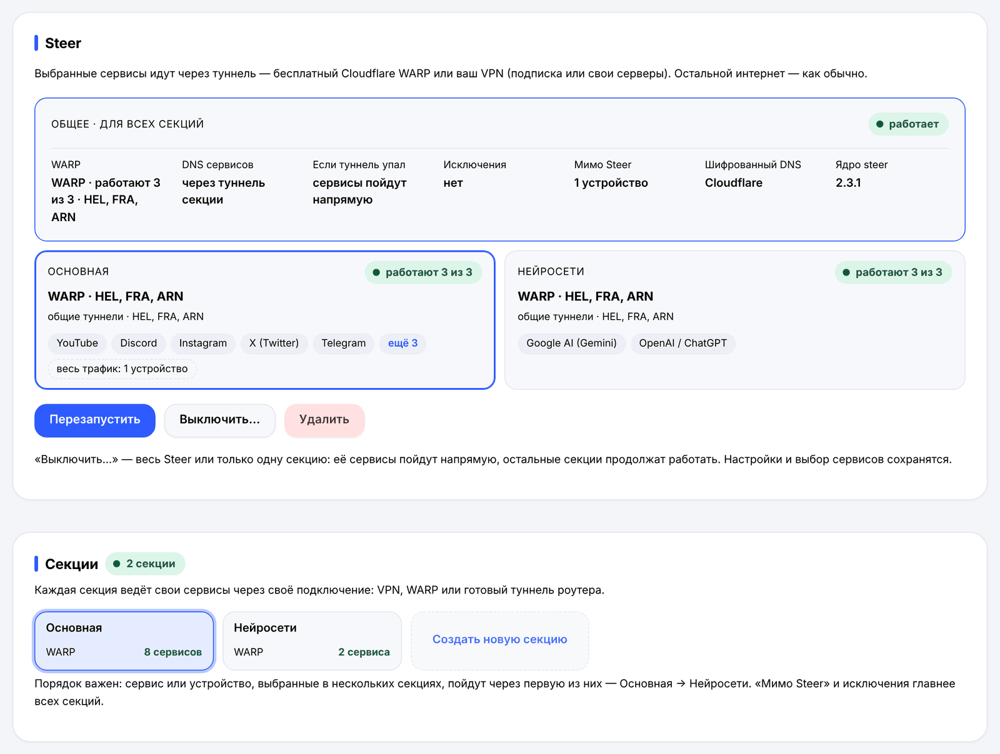</a><br>
  <sub>Карточка Steer: общие настройки, две секции («Основная» и «Нейросети»), сколько туннелей WARP работает и в каких странах.</sub>
</p>

<p align="center">
  <a href="docs/screenshots/steer-services.png">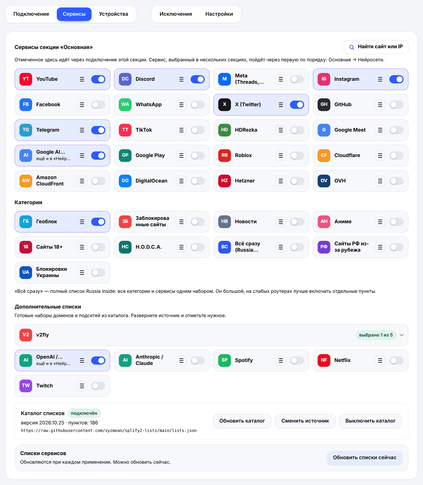</a><br>
  <sub>Вкладка «Сервисы»: включили переключатель — сервис пошёл через туннель. Ниже — категории, дополнительные списки и «Свой список».</sub>
</p>

<details>
<summary><b>Секции — разные сервисы через разные туннели</b></summary>

> **Простыми словами:** можно сделать несколько «маршрутов». Например: видео — через VPN, нейросети — через WARP, игры — через ваш интерфейс AmneziaWG. Если это не нужно — просто не создавайте секций, всё работает одной.

- **До 6 секций**, из них **до 3 с VPN** (каждая VPN-секция держит свой туннель и занимает память роутера).
- У каждой секции **своё название, своё подключение, свои сервисы, свой «Свой список» и свой выбор устройств**. У VPN-секции — своя подписка и свой выбор сервера, они не влияют на другие секции.
- **WARP общий:** все секции с WARP идут через одни и те же туннели WARP.
- **Порядок важен:** сервис или устройство, выбранные в нескольких секциях, пойдут через первую из них. «Мимо Steer» и «Исключения» главнее всех секций.
- **Исключения и Настройки — общие** для всех секций.
- Создать секцию — кнопка **«Свои сервисы через другое подключение»**: придумайте название (например, «Нейросети»), выберите, куда пойдут её сервисы, затем отметьте сервисы.
- Удалить секцию — её сервисы пойдут так, как велят остальные секции, или напрямую; остальные секции не изменятся.

</details>

<details>
<summary><b>Вкладка «Подключение» — через что идут сервисы</b></summary>

Три варианта:

**1. WARP — бесплатно, рекомендуется для начала**

<p align="center">
  <a href="docs/screenshots/steer-warp.png">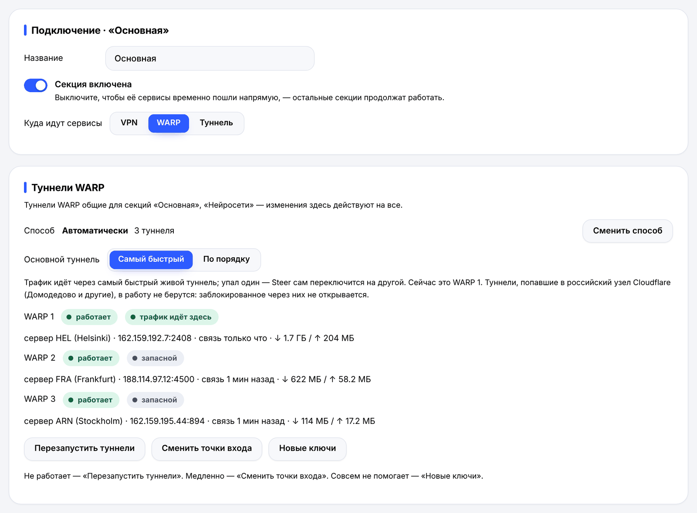</a><br>
  <sub>Три туннеля WARP в разных странах: через какой сейчас идёт трафик, когда была последняя связь, сколько трафика прошло, и кнопки ремонта.</sub>
</p>

- **Автоматический режим (рекомендуется)** — роутер сам получит бесплатные ключи Cloudflare, поставит AmneziaWG, если его нет, проверит точки входа и оставит **3 рабочих туннеля в разных странах**. Займёт 5–10 минут; интернет всё это время работает, страницу можно закрыть — роутер доделает сам. Перед началом панель покажет, что будет делаться, — без подтверждения ничего не начнётся.
- **Какой туннель главный:** «самый быстрый живой» (упал один — Steer сам переключится на другой) или «первый живой по порядку» (порядок меняется стрелками; когда верхний оживёт — Steer вернётся на него).
- **Российские узлы не используются:** туннели, попавшие в российский узел Cloudflare (Домодедово и другие), в работу не берутся — заблокированное через них не открывается. Панель покажет такой туннель и предложит его переделать.
- **Свой конфиг** — вставьте свой WARP.conf или конфиг WireGuard / AmneziaWG: ключи, маскировка и точка входа берутся из него как есть. Конфиг хранится отдельно и переживёт даже переустановку Steer.
- Переключение между режимами — в один клик: прежние туннели выключаются, но сохраняются.
- **Кнопки ремонта:**
  - не работает → **«Перезапустить туннели»**;
  - медленно → **«Сменить точки входа»** (5–10 минут, ключи останутся прежними);
  - совсем не помогает → **«Новые ключи»** (новый аккаунт WARP — если Cloudflare перестал пускать старые);
  - для одного упавшего туннеля — **«Переделать»** только его (1–3 минуты, остальные работают как обычно).
- **Автоподбор мёртвых туннелей** — раз в 10 минут проверяет туннели; неработающему (дольше 30 мин / 1 ч / 3 ч) подбирает новую точку входа. Работающие не трогает, без интернета не запускается.
- **Автоперезапуск** туннелей и Steer по расписанию — помогает, если обход со временем «подвисает».

**2. VPN — ваша подписка или свои серверы**

- Вставьте **ссылку на подписку** (`https://…`) или **ссылки на серверы**: VLESS, Hysteria2, Trojan, Shadowsocks, VMess, SOCKS, HTTP — по одной на строку. Нужные модули ядра поставятся сами. (TUIC, AnyTLS и WireGuard из подписки Steer не берёт.)
- Видно: название подписки, трафик и квоту, срок действия.
- **Проверка задержки:** сначала проверяется, открыт ли порт сервера, затем — **настоящий запрос через него**. Надпись «порт открыт, но не пускает» значит, что сервер отвечает, но трафик не проходит — обычно его блокирует провайдер. Для слабых роутеров есть быстрый режим «только TCP».
- **Выбор сервера:**
  - **«Авто: первый рабочий»** — по порядку подписки; оборвался — ядро само переходит на следующий;
  - **«Авто: по пингу»** — роутер замеряет все серверы и ставит первым самый быстрый; уходит с работающего, только если другой быстрее на заданный «допуск»;
  - **вручную** — нажмите на сервер. Что делать, если он перестал отвечать: держать его, перейти на рабочий или перейти и **вернуться**, когда выбранный снова ответит (проверка раз в 10 минут).
- **Скрыть серверы** — вручную или по словам в названии; новые серверы с таким словом тоже скрываются.
- **Свои серверы** — редактор ссылок: изменить, удалить, добавить по одной или пачкой.
- **Автообновление подписки** — раз в 3 / 6 / 12 / 24 часа (общее для всех секций); если ничего не изменилось — туннель не трогается.

**3. Интерфейс AmneziaWG**

- Сервисы пойдут в готовый туннель с вкладки **AmneziaWG** — WARP или ваш собственный сервер.
- Интерфейс «живёт» на вкладке AmneziaWG: там он чинится автопочинкой, меняется и удаляется. Steer только направляет в него сервисы и при удалении оставит его как есть.
- Если интерфейс выводит трафик через российский узел Cloudflare, панель предупредит и предложит **«Подобрать точку входа»**.

</details>

<details>
<summary><b>Вкладка «Сервисы» — что пустить через туннель</b></summary>

- **Готовые сервисы** — отметьте галочками: YouTube, Discord, Instagram, WhatsApp, X, GitHub, Telegram, TikTok, HDRezka, Google Meet, Gemini, Google Play, Roblox, Cloudflare, CloudFront, DigitalOcean, Hetzner, OVH и другие.
- **Категории** — целые группы: геоблок, заблокированные сайты, новости, аниме, 18+, хостинги, сайты РФ из-за рубежа, блокировки Украины. **«Всё сразу»** — полный список Russia inside одним набором (он большой — на слабых роутерах лучше отдельные пункты).
- **Дополнительные списки** из каталога [splify2-lists](https://github.com/xyzmean/splify2-lists) — сгруппированы по источнику, обновляются при каждом применении. Каталог можно сменить на свой `lists.json` или выключить.
- **Поиск (Ctrl+K)** — впишите сайт или IP, и панель покажет, **какой пункт включить**, чтобы он шёл через туннель. Нет ни в одном списке — предложит добавить в «Свой список».
- **Свой список** — домены (поддомены включаются сами: `example.com` — это и `www.example.com`), IP-адреса и подсети, по одному на строку. Кнопка **«Применить и включить»** — сохранит и сразу включит; переключатель — выключить, не стирая. Можно загрузить файлом `.txt`. У каждой секции — свой.

</details>

<details>
<summary><b>Вкладка «Устройства» — для кого работает</b></summary>

Устройства берутся из списка подключённых, или впишите MAC (`aa:bb:cc:dd:ee:ff`) или IP-адрес вручную.

- **«Мимо Steer»** — эти устройства всегда ходят напрямую, даже к выбранным сервисам. Этот выбор главнее всего и действует во всех секциях. *Зачем:* рабочий ноутбук, банковское приложение на планшете и т.п.
- **«Весь трафик через Steer / через секцию»** — весь интернет устройства идёт через туннель, а не только выбранные сервисы (локальная сеть — напрямую). *Зачем:* для телевизора или приставки, где нельзя выбрать отдельные сервисы.
- **«Только для этих устройств»** (у секции) — сервисы секции идут через неё только с отмеченных устройств, остальные открывают их как обычно. Ничего не отмечено — работает для всех.

</details>

<details>
<summary><b>Вкладка «Исключения»</b></summary>

Домены, IP и подсети, которые **всегда идут напрямую**, мимо WARP и VPN — даже если входят в выбранный сервис. Общие для всех секций. *Зачем:* банки, госуслуги и сервисы, которые ломаются через VPN. Сайты исключайте именно доменом.

</details>

<details>
<summary><b>Вкладка «Настройки» — общие для всех секций</b></summary>

- **Если туннель упал:** «сервисы остановятся» (не откроются, пока туннель не заработает; остальной интернет работает) или «сервисы пойдут напрямую» (как без Steer).
- **DNS сервисов — через туннель** (рекомендуется: сервисы видят ту же страну, что и их трафик) или **через роутер** (сервисы могут видеть Россию и работать не полностью).
- **Точно по IP** — включено (рекомендуется): в туннель идёт всё, что ведёт на адреса сервиса, — так работают и приложения, которые запоминают адреса; иногда за компанию уходят соседние сайты. Выключено: только то, что открыто по имени сайта.
- **Скачивать списки через туннель** — если у провайдера не открывается GitHub (не ответит туннель — скачаются напрямую).

</details>

<details>
<summary><b>Проверка и диагностика</b></summary>

- **«Проверить»** — роутер проверит каждый туннель (через какой сервер, город и страну он выходит, проходит ли HTTPS) и спросит само ядро steer, всё ли на месте. Если что-то не так — подскажет, какую кнопку нажать.
- **«Куда пойдёт запрос»** — введите сайт или IP (и, при желании, IP устройства), и Steer покажет: через WARP, через VPN (через какой узел), напрямую или как исключение — и почему. *Зачем:* главный инструмент, если «почему-то не работает».
- **«Соединения»** — что прямо сейчас идёт через туннель: устройство, адрес и выход. Берётся из памяти роутера в момент нажатия, никуда не сохраняется.
- **«Недавние сайты»** — какие сайты недавно запрашивались и попали ли они в туннель. Журнал живёт только в памяти Steer и обнуляется при перезапуске.
- **Steer и DNS over HTTPS работают вместе.** Если DoH снова начал перехватывать запросы устройств (например, после правки в LuCI) и сервисы пошли мимо туннеля, панель покажет предупреждение с кнопкой **«Исправить»**.

</details>

> [!NOTE]
> Если ядро steer уже занято чем-то другим (splify2, Forkozz, NetShift, ручная настройка), Steer ничего не перезапишет и покажет, кто занял ядро. *Зачем:* чтобы не сломать чужие настройки.

---

### 🍴 Forkozz

> **Простыми словами:** продвинутая версия «только нужные сайты через туннель». Главное отличие — можно сделать **до 9 разных маршрутов**: например, YouTube через сервер в Европе, ChatGPT через WARP, а всё остальное — напрямую.
>
> **Кому нужен:** тем, у кого есть свои серверы или несколько VPN-подписок и кто хочет тонко управлять, что куда идёт. Если нужно попроще — берите Steer (он тоже умеет секции, до 6).

Основан на [NetShift](https://github.com/yandexru45/netshift) и [sing-box](https://github.com/SagerNet/sing-box). Всё ставится только с GitHub и из официального репозитория OpenWrt.

<details>
<summary><b>Секции — «маршруты»</b></summary>

До **9 секций**, у каждой — своё подключение и свой набор сервисов. Если сайт попал в две секции, сработает левая. Один сервис можно выбрать только в одной секции — панель подскажет, где он уже выбран. *Зачем:* для каждого сервиса — свой лучший путь, без путаницы.

На главной странице у каждой секции — карточка: работает ли, какой сервер, задержка, подписка, что через неё идёт.

</details>

<details>
<summary><b>Подключение — куда пойдёт трафик секции</b></summary>

- **Серверы** — ссылки vless, vmess, trojan, ss, socks5, hysteria2, а если это поддерживает установленный sing-box — ещё и **NaïveProxy** (`naive+https://логин:пароль@сервер`).
- **Подписка** — одна или до 10 ссылок; серверы собираются в общий список. *Зачем:* можно объединить несколько VPN-сервисов.
- **Туннель** — готовый интерфейс WireGuard / AmneziaWG (например, WARP из Steer).
- **Дополнительно** — для опытных: формат подписки, группировка серверов по странам, отбор по словам, User-Agent, параметры автовыбора, свой DNS для туннеля, **локальный прокси HTTP/SOCKS5** (для программ, которые умеют работать только через прокси) и другое.
- **Серверы** — «Авто» или «Вручную», проверка задержки всех серверов, сортировка, скрытие лишних, трафик и срок подписки.
- **Сторож** — если выбранный вручную сервер перестал отвечать, Forkozz переключается на автовыбор и показывает, какой сервер упал. *Зачем:* связь не пропадёт, а вы узнаете о проблеме.

</details>

<details>
<summary><b>Сервисы, исключения, устройства</b></summary>

- **Сервисы** — тот же каталог, что в Steer, плюс свои сайты, адреса и внешние списки.
- **Исключения** — сайты, которые **всегда** идут напрямую. *Зачем:* банки и госсервисы часто не работают через VPN.
- **Устройства** — «Всё через Forkozz» (например, телевизор или приставка, где VPN не поставить) и «Мимо Forkozz» (тем, кому он мешает).
- **Обновить списки сейчас** — с понятным отчётом, что скачалось и были ли ошибки.

</details>

<details>
<summary><b>Настройки</b></summary>

- **DNS** — до **8 серверов с автопереключением** (если первый перестал отвечать — переходит на следующий и возвращается, когда первый оживёт), кнопка **«Подобрать лучшие»**, «Не пускать приложения в обход DNS роутера» и другое. *Зачем:* без стабильного DNS не работает маршрутизация по сайтам.
- **Сеть** — подстройка под вашу схему: какие сети обслуживать, через какой интерфейс выходить, IPv6.
- **Прочее** — отключение QUIC для выбранных сервисов, торренты напрямую (*зачем:* не тратить трафик подписки), интервал обновления списков.
- **sing-box** — облегчённый, обычный или **расширенный** ([sing-box-extended](https://github.com/shtorm-7/sing-box-extended), есть облегчённый и компактный варианты — для роутеров с малым флешем). Расширенный ставится **сам**, если в подписке есть протоколы, которым он нужен (XHTTP, VMess). Если новая версия не заработала — возвращается прежняя.
- **Панель sing-box (YACD)** — наглядно: какие соединения куда идут, трафик в реальном времени.

</details>

<details>
<summary><b>Проверка и переход со старого Forkop</b></summary>

- **Проверка** — служба, sing-box, DNS, ответ сервера каждой секции, исключения. *Зачем:* найти, что именно сломалось.
- **«Куда пойдёт запрос»** — введите сайт и увидите: через какую секцию, напрямую, исключение или блок.
- **Трафик** — скорость, объём, число соединений, память.
- **Переход с Forkop одной кнопкой** — все подключения, секции, списки, исключения, устройства и DNS переносятся сами, старый движок удаляется. *Зачем:* не настраивать всё заново.
- **Работает с Удалённым доступом** — телефоны, подключённые через Tailscale, Forkozz обслуживает так же, как домашние устройства. Если после удаления Tailscale остались «хвосты», панель предложит **«Убрать остатки»** одной кнопкой.

</details>

---

### ▶️ ByeTube

> **Простыми словами:** обход **только для YouTube**. Ничего лишнего: без серверов, подписок и туннелей, остальной интернет вообще не затрагивается.
>
> **Кому нужен:** если из всего нужен только YouTube, а Zapret по какой-то причине не подходит.

Основан на [ByeDPI](https://github.com/DPITrickster/ByeDPI-OpenWrt) + `hev-socks5-tunnel`. Роутер сам запоминает адреса YouTube и пускает только их через ByeDPI.

- **Статус** — каждое звено цепочки по отдельности. *Зачем:* видно, где именно сбой.
- **Настройки** — QUIC: блокировать (рекомендуется) или через прокси; IPv6. *Зачем:* блокировка QUIC заставляет YouTube перейти на более надёжный способ.
- **Стратегия** — 6 готовых или своя.
- **Тест стратегий** — каждая проверяется в **отдельной временной копии**, поэтому у домашних YouTube в это время не ломается.
- **Домены** — встроенный список YouTube + можно добавить свои сайты.
- Для диагностики в SSH: `bytetube diag <IP или имя телефона>` — покажет, куда реально уходят запросы устройства. *Зачем:* часто виноват включённый на телефоне «Частный DNS».

---

### 🏹 TG WS Proxy

> **Простыми словами:** прокси для Telegram прямо на роутере. Добавляете его в Telegram одним касанием (по ссылке или QR-коду) — и Telegram работает стабильно, **без VPN на телефоне**.

На выбор четыре варианта (можно поставить несколько):

| Вариант | Порт | Источник |
|---|---|---|
| **Go (MTProto)** | 1443 | [spatiumstas/tg-ws-proxy-go](https://github.com/spatiumstas/tg-ws-proxy-go) |
| **SOCKS5** | 2080 | [d0mhate/-tg-ws-proxy-Manager-go](https://github.com/d0mhate/-tg-ws-proxy-Manager-go) |
| **Rust (MTProto)** | 2443 | [valnesfjord/tg-ws-proxy-rs](https://github.com/valnesfjord/tg-ws-proxy-rs) |
| **sTGWS** | — | [xyzmean/brb](https://gitlab.com/xyzmean/brb) |

<p align="center">
  <a href="docs/screenshots/tg-ws-proxy.png">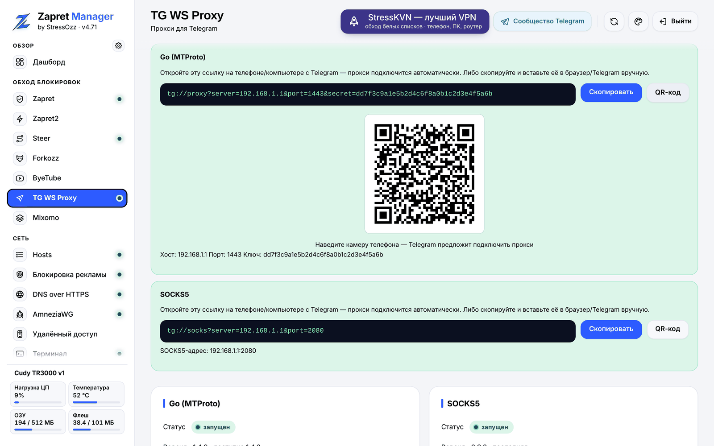</a><br>
  <sub>Готовая ссылка и QR-код для Telegram. Ниже — карточки каждого варианта прокси с версией, портом и кнопками.</sub>
</p>

- **Как подключить в Telegram:** для каждого запущенного прокси есть готовая ссылка `tg://`, кнопка «Скопировать» и **QR-код** — наведите камеру телефона, и Telegram предложит добавить прокси.

<details>
<summary><b>Пошагово: как добавить прокси в Telegram на телефоне</b></summary>

1. Телефон должен быть подключён к **домашнему Wi-Fi** (прокси живёт на роутере).
2. Откройте в панели **TG WS Proxy** и нажмите **«QR-код»** у запущенного прокси.
3. Наведите камеру телефона на QR-код и нажмите на появившуюся ссылку — откроется Telegram.
4. Telegram спросит «Подключить прокси?» — нажмите **«Подключить»**.
5. Готово: в настройках Telegram (раздел **«Данные и память»** → настройки прокси) он будет помечен как подключённый.

Если камера не открывает ссылку — нажмите **«Скопировать»** и отправьте ссылку себе в «Избранное» в Telegram, затем нажмите на неё там.

> [!NOTE]
> Вне дома этот прокси не работает (если не настроен [Удалённый доступ](#-удалённый-доступ-tailscale)). Telegram сам переключится на прямое соединение, но удобнее выключить прокси переключателем в тех же настройках.

</details>

- Ставится последняя версия с GitHub; если для вашего роутера сборки нет — проверенная.
- Удаление срабатывает всегда, даже если обычное удаление «упирается».
- Если Rust-прокси уже стоит отдельно (`luci-app-tg-ws-proxy-rs`), панель его не трогает, а только показывает настройки.
- sTGWS: кнопка **«подобрать новый домен»** — если текущий перестал работать.
- **Автоперезапуск** (раз в 1–12 ч) и **сторож** — упавший прокси сам поднимается в течение 2 минут.

---

### 🧱 Mixomo

> **Простыми словами:** готовый набор «VPN по подписке только для нужных сайтов» с наглядной веб-панелью. Вставили подписку, выбрали списки сайтов — работает.
>
> **Кому нужен:** тем, у кого есть VPN-подписка и кто хочет удобную панель с выбором серверов.

Связка трёх программ: **Mihomo** (подключается к VPN), **hev-socks5-tunnel** (мост) и **MagiTrickle** (решает, какие сайты пустить в туннель). На основе [Mixomo от Internet-Helper](https://github.com/Internet-Helper).

- **Установка** всего набора одной кнопкой, запуск / остановка / обновление.
- **Веб-панель Mihomo** — MetaCubeXD или Zashboard (порт 9090): видно соединения и серверы, можно выбрать сервер вручную.
- **Подписка** — вставьте ссылку; панель создаст готовую конфигурацию (с отдельным маршрутом для YouTube).
- **Исключить серверы** из подписки — вручную или по словам.
- **Автоперезапуск** — раз в 2 / 6 часов или раз в день.
- **Редактор конфигурации** — если Mihomo не запустился с новыми настройками, **всё откатывается назад**. *Зачем:* опечатка не оставит вас без связи.
- **MagiTrickle** — готовые списки сайтов (Internet Helper, ITDog) и окно управления.
- **«Пустить весь трафик через Mixomo»** — переключатель: в туннель пойдёт весь IPv4-трафик устройств, а не только сайты из списков (локальная сеть и сам роутер работают как обычно). Выключили — снова только сайты из списков.
- **WARP** — бесплатный туннель, если своей подписки нет: «Сгенерировать WARP» (быстро) или «С подбором точки входа» (роутер проверит точки настоящим туннелем и возьмёт зарубежную). Можно вставить и свой готовый WARP.conf. Файл общий с вкладкой AmneziaWG.

---

### 📝 Hosts

> **Простыми словами:** некоторые сайты блокируют «по-простому» — провайдер подсовывает неправильный адрес. Файл hosts позволяет записать **правильный адрес** вручную, и сайт открывается без прокси и туннелей. Здесь это делается галочками.

<p align="center">
  <a href="docs/screenshots/hosts.png">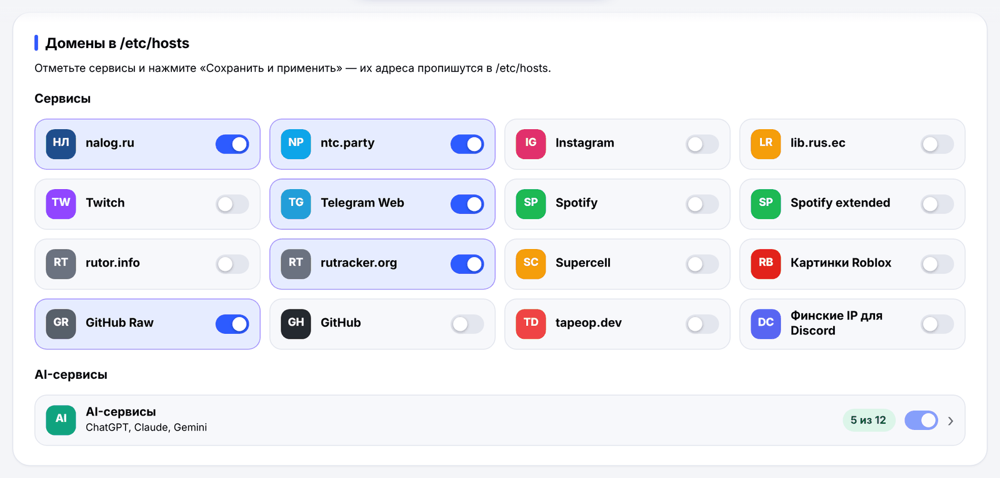</a><br>
  <sub>Готовые наборы включаются переключателем. AI-сервисы собраны в одну группу — стрелка справа раскрывает её.</sub>
</p>

- **Готовые наборы** — отметьте нужные и нажмите «Сохранить и применить»: nalog.ru, ntc.party, Instagram/Facebook, lib.rus.ec, **AI-сервисы** (ChatGPT, Claude, Gemini, Grok, DeepL, Copilot, ElevenLabs, Windsurf и др.), Twitch, Telegram Web, Spotify, rutor, rutracker, Supercell, GitHub, финские IP Discord и другие.
- **Готовые большие списки** — **GeoHide RU / EU / US** ([GeoHideDNS](https://github.com/Internet-Helper/GeoHideDNS)) или **dns.malw.link** для обхода гео-ограничений. ⚠ Полностью заменяют файл hosts — все отмеченные наборы и ваши записи будут удалены.
- **Восстановить hosts** — вернуть чистый файл, если что-то пошло не так.
- **Редактор** всего файла (с резервной копией `/etc/hosts.bak`). Для очень больших файлов редактор отключается, чтобы не перегружать роутер.

> [!WARNING]
> Запись в hosts привязывает сайт к **одному** IP-адресу. Сегодня адрес работает — завтра может перестать, и тогда сервис **не откроется даже с VPN или DoH**. Если какой-то сервис вдруг перестал открываться — снимите его галочку здесь или нажмите «Восстановить hosts».

---

### 🚫 Блокировка рекламы

> **Простыми словами:** роутер просто «не отвечает», когда устройство пытается загрузить рекламу или следящий скрипт, — и реклама не появляется. Работает **сразу на всех устройствах**: телефонах, ТВ, приставках, компьютерах. Ничего ставить на них не нужно.

Используются известные списки [HaGeZi](https://github.com/hagezi/dns-blocklists), они обновляются сами каждый день.

<p align="center">
  <a href="docs/screenshots/adblock.png">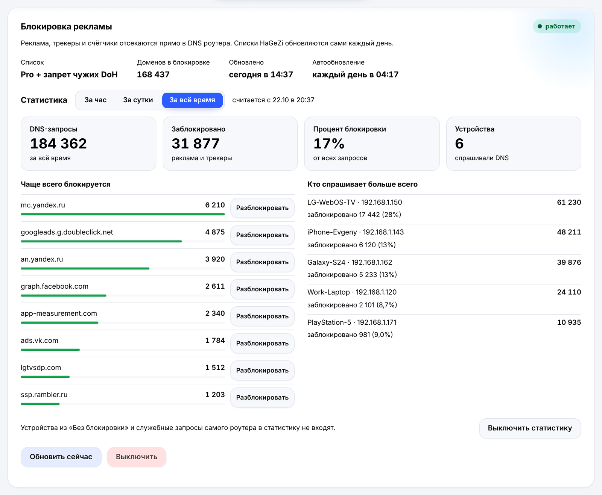</a><br>
  <sub>Главная карточка: какой список включён, сколько доменов блокируется, статистика и «кто спрашивает больше всего».</sub>
</p>

<details>
<summary><b>📸 Скриншот: выбор строгости списка</b></summary>
<br>
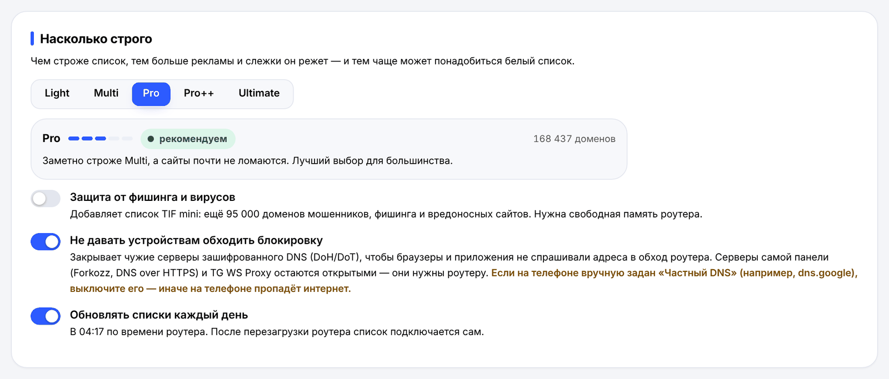
</details>

**Насколько строго блокировать:**

| Список | Что делает |
|---|---|
| **Light** | Только самая явная реклама и трекеры. Почти ничего не ломает — всё как раньше, просто чище. |
| **Multi** | Обычная защита: реклама, трекеры, счётчики, телеметрия и известные вредоносные сайты. |
| **Pro** *(по умолчанию)* | Заметно строже Multi, а сайты почти не ломаются. **Лучший выбор для большинства.** |
| **Pro++** | Ещё строже. Иногда перестают открываться ссылки из рекламы и редкие сервисы — их можно вернуть белым списком. |
| **Ultimate** | Максимум. Понадобится белый список: часть сайтов и приложений может работать не полностью. |

- **TIF mini** — дополнительно блокирует мошеннические, фишинговые и вредоносные сайты. Нужна свободная память.
- **«Не давать устройствам обходить блокировку»** — закрывает чужие серверы шифрованного DNS (DoH/DoT), чтобы браузеры и приложения не спрашивали адреса в обход роутера. Серверы самой панели (DoH, Forkozz) не блокируются. ⚠ Если на телефоне вручную задан «Частный DNS» (например, `dns.google`) — выключите его, иначе на телефоне пропадёт интернет.
- **Белый список** — домены, которые **не блокируются никогда** (вместе с поддоменами). Сразу заполнен тем, без чего не открываются переходы из поисковой рекламы, писем и кешбэк-сервисов (Яндекс, Mail.ru, AliExpress).
- **Чёрный список** — домены, которые **блокируются всегда**, даже если их нет в выбранном списке. *Зачем:* например, чтобы телевизор или приставка не скачивали обновления. Если домен есть и в белом, и в чёрном — он блокируется.
- **Ещё всегда в исключениях** (добавляет сама панель, убрать нельзя): серверы DNS панели, Telegram и прокси Cloudflare, адреса проверки интернета — без них телевизоры и телефоны решают, что «интернета нет».
- **Устройства без блокировки** — для отмеченных устройств реклама не блокируется. *Зачем:* например, если у ТВ-приставки перестали работать IPTV или приложения. Forkozz и Steer для них работают как раньше.
- **«Проверить домен»** — сайт или приложение перестали работать? Впишите домен, и панель покажет, режет ли его список, — и разблокирует одной кнопкой.
- **Статистика** (по желанию) — сколько DNS-запросов было, сколько заблокировано, сколько устройств в сети и что режется чаще всего. Журнал хранится в памяти роутера, а не на флеше.
- **Безопасно:** новый список сначала проверяется, а если после применения DNS роутера не отвечает 30 секунд — **всё возвращается как было**. Скачивается с GitHub, а если он недоступен — через jsDelivr.
- **Следит за памятью:** если её мало, панель не даст поставить тяжёлый список и подскажет, какой выбрать.
- После перезагрузки роутера список **подключается сам**.
- **«Выключить»** — одной кнопкой. *Зачем:* быстро проверить, не блокировка ли виновата в проблеме.

---

### 🔐 DNS over HTTPS

> **Простыми словами:** каждый раз, когда вы открываете сайт, устройство спрашивает «где находится этот сайт?». Обычно этот вопрос идёт открытым текстом, и провайдер может его подсмотреть или **подсунуть неправильный ответ** (это частый способ блокировки). DoH шифрует эти вопросы — для всей сети сразу.

На базе `https-dns-proxy`.

<p align="center">
  <a href="docs/screenshots/doh.png">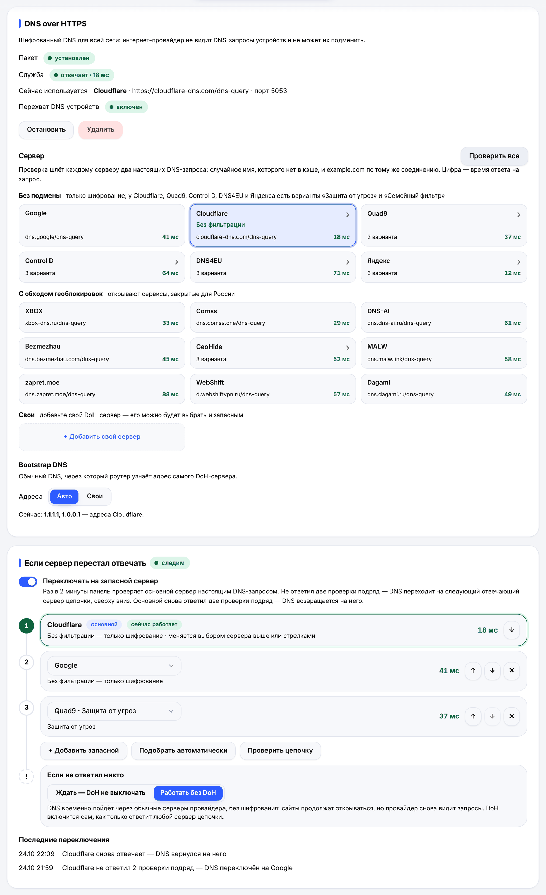</a><br>
  <sub>Выбор сервера с замером скорости ответа («Проверить все») и цепочка запасных серверов с журналом переключений.</sub>
</p>

**Серверы на выбор:**

| Группа | Серверы |
|---|---|
| **Без подмены** — только шифрование | Google, Cloudflare, Quad9, Control D, DNS4EU, Яндекс |
| **«Защита от угроз»** — блокируют вредоносные и фишинговые сайты | Cloudflare, Quad9, Control D, DNS4EU, Яндекс |
| **«Семейный фильтр»** — блокируют угрозы и сайты для взрослых | Cloudflare, Control D, DNS4EU, Яндекс |
| **С обходом геоблокировок** — открывают сервисы, закрытые для России (ChatGPT, Gemini и др.) | XBOX, Comss, DNS-AI, Bezmezhau, GeoHide RU / EU / US, MALW, zapret.moe, WebShift, Dagami |
| **Свои** | Добавьте любой сервер DoH по ссылке (`https://dns.example.com/dns-query`, можно только имя) |

- **«Проверить»** — каждому серверу отправляются настоящие DNS-запросы и показывается время ответа. Если соединение с сервером обрывает провайдер, панель так и скажет и предложит включить **«Обход блокировки DoH»** в Zapret.
- **«Подобрать автоматически»** — панель сама выберет самые быстрые из отвечающих серверов.
- **Основной и запасные серверы.** Включите **«Переключать на запасной сервер»**: раз в 2 минуты панель проверяет основной сервер, и если он не ответил две проверки подряд — DNS переходит на следующий в цепочке, а когда основной оживёт — возвращается на него. *Зачем:* серверы DoH иногда блокируют или они падают — тот, что работает сегодня, может пропасть завтра.
- **Если не отвечает ни один сервер цепочки:** «Работать без DoH» (сайты продолжат открываться через обычный DNS провайдера, DoH включится сам, как только сервер ответит) или «Ждать — DoH не выключать» (запросы не уходят провайдеру, но новые сайты могут не открываться).
- **Российские сайты (.ru, .su, .рф)** — можно узнавать у **Яндекс DNS** (российские сайты открываются с ближайших серверов), у **DNS провайдера** или **через DoH**. *Зачем:* зарубежный сервер иногда отдаёт адреса российских сайтов не в России — Госуслуги, банки и онлайн-кинотеатры могут работать хуже.
- **Перехват DNS устройств** — «Авто»: даже если на устройстве вручную прописан другой DNS, оно всё равно получит защищённый. Работает и вместе со Steer.
- **«Не давать браузерам свой DNS»** — подсказывает браузерам (и Частному узлу iCloud на iPhone/Mac) не узнавать адреса в обход роутера. *Зачем:* иначе для них не работают DoH, блокировка рекламы и маршрутизация Steer/Forkozz. Не слушают подсказку только браузеры, где свой DNS включили вручную.
- **Bootstrap DNS** — технический пункт: через какой обычный DNS роутер узнаёт адрес самого DoH-сервера. Обычно можно оставить «Авто».
- Если на роутере стоит **DNS Manager**, панель не трогает его настройки, чтобы две программы не переписывали друг друга.
- Удаление полное — роутер возвращается к обычному DNS.

> [!WARNING]
> Если сервер DoH перестал отвечать, **сайты не открываются ни на одном устройстве, хотя интернет есть**. Поэтому включите запасные серверы — или, если такое случилось, выберите другой сервер или удалите DoH.

> [!NOTE]
> Если стоит Forkozz, DoH не нужен — Forkozz сам шифрует DNS.

---

### 🔒 AmneziaWG

> **Простыми словами:** WireGuard — популярный быстрый VPN-протокол, но провайдеры научились его узнавать и блокировать. AmneziaWG — тот же WireGuard, но «в маскировке», его гораздо сложнее заметить. Этот раздел — для управления такими туннелями.
>
> **Кому нужен:** если у вас свой сервер или конфиг AmneziaWG / WireGuard, или вы хотите сделать бесплатный туннель WARP и пустить через него Steer, Forkozz или весь интернет. Для автоматического WARP в Steer всё ставится само.

<details>
<summary><b>📸 Скриншот: раздел AmneziaWG</b></summary>
<br>
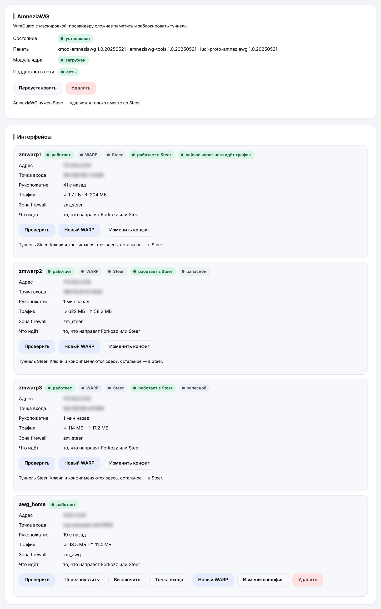
<br><sub>Пакеты и список туннелей: какие из них ведёт Steer, через какой сейчас идёт трафик, точка входа и трафик. Адрес своего сервера панель прячет, пока его не раскроешь.</sub>
</details>

- **Установка** — нужные программы под точную версию вашей прошивки (сборки [2Grey/awg-openwrt](https://github.com/2Grey/awg-openwrt)). Если не получилось, панель подробно объяснит почему.
- **Список туннелей** — все туннели AmneziaWG (в том числе туннели Steer): работает ли, адрес, точка входа, трафик, когда была последняя связь, и **где используется** (в Steer, в Forkozz, «весь трафик роутера»).
  - **Проверить** — какой у туннеля внешний адрес и страна, есть ли потери и обрывы (если DPI рвёт туннель через пару секунд — панель скажет и посоветует другую точку входа или маску).
  - Перезапустить, включить/выключить, **«Точка входа»** (сменить или подобрать — роутер проверит точки WARP изнутри туннеля и возьмёт самую быструю рабочую), **«Новый WARP»** (новые ключи), показать/изменить конфиг, удалить.
- **Создать WARP.conf** — четыре способа:

  | Способ | Что делает |
  |---|---|
  | **Быстро** | Стандартная точка входа, маскировка под SIP-звонок. Подойдёт, если WARP у провайдера не режется. |
  | **С подбором точки входа** | Роутер проверит точки Cloudflare и возьмёт зарубежную — через российские (DME и др.) часть сайтов не открывается. |
  | **С проверкой связи** | Ключи, точки входа и маски перебираются настоящим туннелем — записывается связка, где трафик реально идёт. **Самый надёжный способ.** |
  | **Своя точка входа** | Как «Быстро», но с вашим `адресом:портом` — если знаете точку, которая у вас работает. |

  Файл WARP.conf общий с Mixomo.
- **Создать интерфейс** — из WARP.conf или своего `.conf`, с «доступом из сети» (без него устройства туннелем не воспользуются) и опцией «весь трафик в туннель» (⚠ упадёт туннель — пропадёт интернет). Что пускать в туннель — выбирается в Steer или Forkozz.
- **Автопочинка WARP** — раз в 10 минут роутер проверяет отмеченные туннели WARP. Если туннель не работает **или ушёл на российский узел Cloudflare** дольше выбранного времени, роутер подбирает ему зарубежную точку входа, а с третьей попытки — ещё и новые ключи. Новая настройка остаётся, **только если стало лучше**, иначе возвращается прежняя. Работающие туннели не трогаются. *Зачем:* туннели чинятся сами.
- При удалении панель предупредит, если через туннель идут Steer, Forkozz или весь интернет роутера.

---

### 📱 Удалённый доступ (Tailscale)

> **Простыми словами:** вы ушли из дома — а обход блокировок остался на домашнем роутере. «Удалённый доступ» это исправляет: телефон **в любой сети** (мобильный интернет, кафе, поездка) выходит в интернет **через домашний роутер** — и Zapret, Steer, Forkozz, блокировка рекламы и Telegram через sTGWS работают для него как дома. А ещё с телефона откроются роутер, эта панель и устройства дома.
>
> **Кому нужен:** тем, кто хочет обход и на телефоне вне дома, без отдельного VPN-сервиса.

> [!IMPORTANT]
> **Не для новичков.** Ставьте, только если готовы разобраться, как настраивается Tailscale: сервер, одобрение маршрутов, приложение на телефоне. Панель ведёт по шагам, но часть шагов делается в панели сервера и на телефоне. Белые списки этот способ не обходит — для них есть [StressKVN](https://github.com/StressOzz/StressKVN).

Работает на [Tailscale](https://github.com/tailscale/tailscale): устройства находят друг друга через сервер, а сам трафик идёт **напрямую** между телефоном и роутером и зашифрован — сервер его не видит. Ставится уменьшенная сборка [openwrt-tailscale](https://github.com/GuNanOvO/openwrt-tailscale) и страница для LuCI с GitHub; панель заранее покажет, сколько флеш-памяти нужно.

**Где будет ваша сеть — на выбор:**

| Вариант | Что это |
|---|---|
| **Routerich** *(рекомендуется)* | Вход **по ключу, без аккаунта**. Сеть создаётся в один клик на `remote.routerich.ru` (кнопка «Create My Tailnet»). Работает из России. |
| **Аккаунт Tailscale** | Вход через Google, Apple, Microsoft или GitHub. Сайт Tailscale из России часто не открывается. |
| **Свой сервер** | Headscale, ionscale или другой совместимый сервер. |

> [!TIP]
> При создании сети в Routerich **сохраните оба ключа** (кнопка «Download Details») — их показывают один раз. **Management Key** — для входа в панель Routerich, **Device Auth Key** — для роутера и телефона. Ключ действует год.

**Как подключить — по шагам:**

1. **Установите** Tailscale на этой странице и выберите, где ваша сеть.
2. **Подключите роутер** — вставьте Device Auth Key (Routerich) или войдите по ссылке (аккаунт Tailscale). Панель сама включит «выход в интернет через роутер» и «доступ к домашней сети» и настроит сеть и firewall.
3. **Одобрите роутер на сервере** (один раз) — в панели сервера отметьте домашнюю подсеть и «выходной узел» (Exit Node). Панель покажет, где именно это нажать.
4. **Настройте DNS** (один раз) — в панели сервера укажите адрес роутера как сервер имён. *Зачем:* чтобы телефон узнавал адреса сайтов у роутера — так работают Steer, Forkozz, Mixomo и блокировка рекламы.
5. **На телефоне** установите приложение Tailscale (или неофициальный клиент [TailSocks](https://github.com/bropines/tailsocks) для Android), войдите **с тем же ключом или аккаунтом**, что и роутер, выберите роутер как **Exit Node** и включите VPN — готово.

Панель подробно расписывает каждый шаг прямо на странице, включая настройки TailSocks и подключение **ноутбука в поездке** (одна команда для терминала).

- **Статус** — подключён ли роутер, одобрен ли он на сервере, работают ли выход в интернет и доступ к домашней сети.
- **Переключатели** — «Выход в интернет через роутер» и «Доступ к домашней сети».
- **Сам следит за порядком:** раз в минуту проверяет, что всё на месте, и возвращает настройки — после входа через LuCI, перезагрузки роутера, обновления Forkozz, Zapret или sTGWS. Tailscale работает без своих правил firewall и без MagicDNS на роутере, чтобы не мешать Steer и Forkozz.
- Если сменился адрес роутера в домашней сети — панель перенастроит всё сама и подскажет, что поменять в DNS на сервере.
- Предупредит, когда **вход роутера скоро истечёт**, и подскажет, как сделать его бессрочным.
- Кнопки: «Перезапустить», «Настроить для телефона», «Отключить роутер», «Удалить» (сеть, firewall и DNS вернутся к прежнему виду).

> [!NOTE]
> **Дома VPN Tailscale на телефоне выключайте** — в домашнем Wi-Fi обход и так работает, а через Tailscale трафик идёт лишним кругом.

---

### 💻 Терминал

> **Простыми словами:** командная строка роутера (то же, что SSH) — прямо в браузере. Не нужно ставить никаких программ, работает даже с телефона.

На базе [ttyd](https://github.com/tsl0922/ttyd).

- **Установка в один клик** — около 1 МБ, запускается сам.
- **Безопасно**: доступен **только из домашней сети**, вход — по логину и паролю роутера.
- **Встроен в панель** — открывается прямо на странице. Если панель открыта по `https`, терминал откроется в отдельной вкладке (браузер не разрешает смешивать).
- **«Открывать через Tailscale»** — если настроен [Удалённый доступ](#-удалённый-доступ-tailscale), терминал можно открыть и вне дома, с телефона. Из интернета он всё равно закрыт.
- **Кнопки**: «Открыть в новой вкладке», «Перезапустить», «Удалить».

---

### 📈 Монитор ресурсов

> **Простыми словами:** «Диспетчер задач», как в Windows, только для роутера. Показывает, насколько загружен процессор, сколько свободно памяти, не перегревается ли роутер и **какая программа всё это занимает**.
>
> **Когда нужен:** интернет стал тормозить, роутер «задумывается», страницы долго открываются — здесь сразу видно, в чём дело.

<p align="center">
  <a href="docs/screenshots/monitor.png">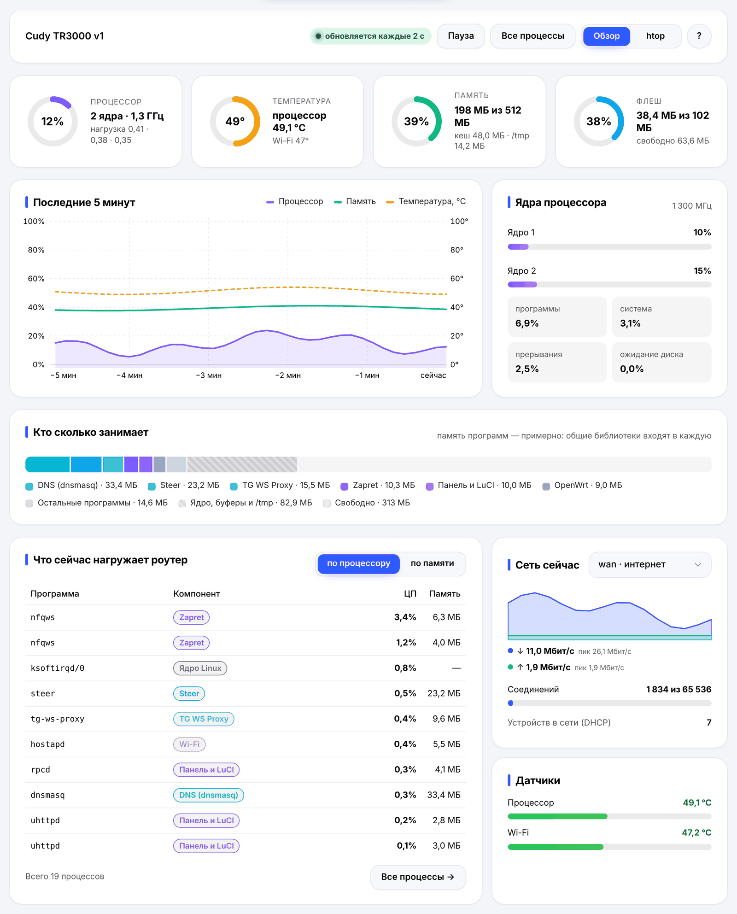</a><br>
  <sub>Вкладка «Обзор»: кольца загрузки, графики за 5 минут, ядра процессора, «кто сколько занимает», топ процессов, сеть и датчики.</sub>
</p>

**Вкладка «Обзор»** — обновляется каждые **2 секунды**:
- **Процессор** — общая нагрузка и **каждое ядро** отдельно; сколько занимают программы, система, прерывания.
- **Память** — сколько занято и свободно.
- **Флеш** и **/tmp** — сколько места осталось.
- **Температура** — с подсказкой: до 85 °C — в норме. Если датчика у роутера нет, так и будет написано.
- **Графики за последние 5 минут** — процессор, память, температура. *Зачем:* видно не только «сейчас», но и что было минуту назад.
- **Сеть сейчас** — скорость загрузки и отдачи (с графиком за 2 минуты), число соединений, сколько устройств подключено. Можно выбрать, **какой сетевой интерфейс показывать** — например, интернет (WAN), домашнюю сеть или туннель; выбор запоминается.
- **Роутер** — модель, процессор, частота, объём памяти, сколько работает без перезагрузки.

**«Кто сколько занимает»** — память и процессор **по компонентам панели** (Zapret, Forkozz, Steer, прокси и т.д.), отдельно — ядро системы и остальные программы. *Зачем:* сразу понятно, какой инструмент нагружает роутер.

**«Что сейчас нагружает роутер»** — топ программ по процессору или по памяти.

**«Все процессы»** — полный список программ с поиском и сортировкой, фильтры «Компоненты панели» / «Ядро». Любую программу можно **завершить**: сначала панель вежливо попросит её закрыться, а если не закроется — можно принудительно. Важные системные службы помечены, чтобы случайно не «уронить» роутер.

**Вкладка «htop»** — привычный консольный диспетчер процессов прямо на странице. Ставится в один клик (заодно поставится «Терминал»). Работает только из домашней сети и сам выключается, когда вы уходите с вкладки.

**Кнопка «Пауза»** — остановить обновление.

> [!TIP]
> **Монитор почти не нагружает роутер:** он работает **только пока страница открыта**. Закрыли — роутер ничего не собирает. Хотите следить за роутером — откройте монитор в отдельной вкладке браузера и занимайтесь своими делами; потом загляните — график покажет, что происходило за последние 5 минут.

---

### ⚙️ Система

> **Простыми словами:** настройки роутера, резервные копии, диагностика, обновления, очистка и удаление. В Web UI этот раздел разбит на подразделы прямо в меню.

#### Параметры роутера

<details>
<summary><b>📸 Скриншот: раздел «Система»</b></summary>
<br>
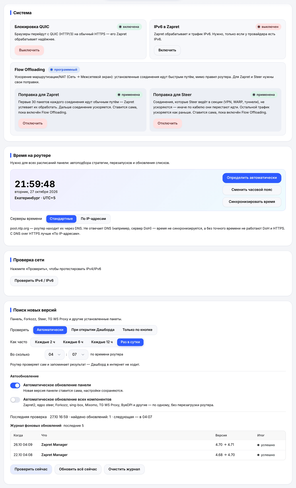
<br><sub>Блокировка QUIC, IPv6, поправки Flow Offloading, время на роутере, проверка сети и поиск новых версий с автообновлением.</sub>
</details>

- **Блокировка QUIC** — *зачем:* браузеры всё чаще используют протокол QUIC, который может проходить мимо обхода. Блокировка заставляет их вернуться на обычный способ, который обходится надёжно.
- **IPv6 в Zapret** — *зачем:* если у вашего провайдера есть IPv6, без этой галочки часть трафика пойдёт мимо обхода.
- **Fix для Flow Offloading** — *зачем:* функция «ускорения» роутера пропускает пакеты в обход Zapret, и обход перестаёт работать. Фикс это исправляет.
- **Время на роутере** — часы, **автоопределение часового пояса** и синхронизация времени (даже если провайдер закрыл обычные серверы времени). *Зачем:* от правильного времени зависят все расписания панели, а ещё HTTPS и VPN.
- **Проверка сети** — есть ли интернет по IPv4 и IPv6. *Зачем:* быстро понять, виноват интернет или настройки.
- **Зеркало OpenWrt** — сменить источник, откуда роутер качает программы. Перед переключением панель проверяет, что зеркало работает, иначе оставляет прежнее. А если основной репозиторий OpenWrt отвечает с ошибками, панель **сама** подберёт самое быстрое рабочее зеркало. *Зачем:* если стандартный не открывается, программы не ставятся.
- **Поиск новых версий** — как панель узнаёт о новых версиях (самой панели, Forkozz, Steer, TG WS Proxy и других):
  - **раз в сутки ночью** (по умолчанию) — роутер проверяет около 04:00 и запоминает; Дашборд открывается быстро и в интернет не ходит;
  - **при каждом открытии Дашборда** — сведения всегда свежие, но роутер ходит в интернет при каждом заходе;
  - **только кнопкой** «Проверить» — роутер сам ничего не проверяет.
- **Список изменений** — что нового в каждой версии Zapret Manager. Берётся с GitHub, а если он недоступен — показывается копия, сохранённая на роутере при установке.

#### Фоновые проверки

**Сторож панели** раз в 2 минуты проверяет, что всё работает, и сам чинит сбои (подробнее — в разделе [Расписания (cron)](#расписания-cron)). Если делать нечего — выходит сразу, почти не нагружая роутер.

- Показано, **за чем он следит** и когда была последняя проверка; кнопка **«Проверить сейчас»**.
- Можно **выключить**, если не хотите, чтобы роутер что-то делал в фоне. Тогда после сбоя или перезагрузки чинить придётся вручную — панель честно предупредит об этом. Расписания, которые вы включили сами (автотест, автообновление списков и т.п.), этот переключатель не трогает.

#### Системная информация

**Отчёт одним кликом**: память, система, сеть, провайдер, каждый установленный компонент с настройками, стратегия, пакеты и доступность ~40 сайтов. Займёт до минуты.

- **Адреса, ключи, пароли и ссылки подписок в отчёт не попадают** — его можно смело отправлять в чат поддержки.
- Кнопки **«Скопировать отчёт»** и **«Сохранить в файл»** (текстовый файл).
- *Зачем:* когда просите помощи в [сообществе](https://t.me/stressozz_manager), вместо десятка вопросов «а что у вас стоит?» достаточно прислать отчёт.

#### 💾 Резервная копия панели

> **Простыми словами:** «точка восстановления», как в Windows. Сделали копию → экспериментировали → что-то сломали → нажали «Восстановить» → всё как было.

<p align="center">
  <a href="docs/screenshots/backup.png">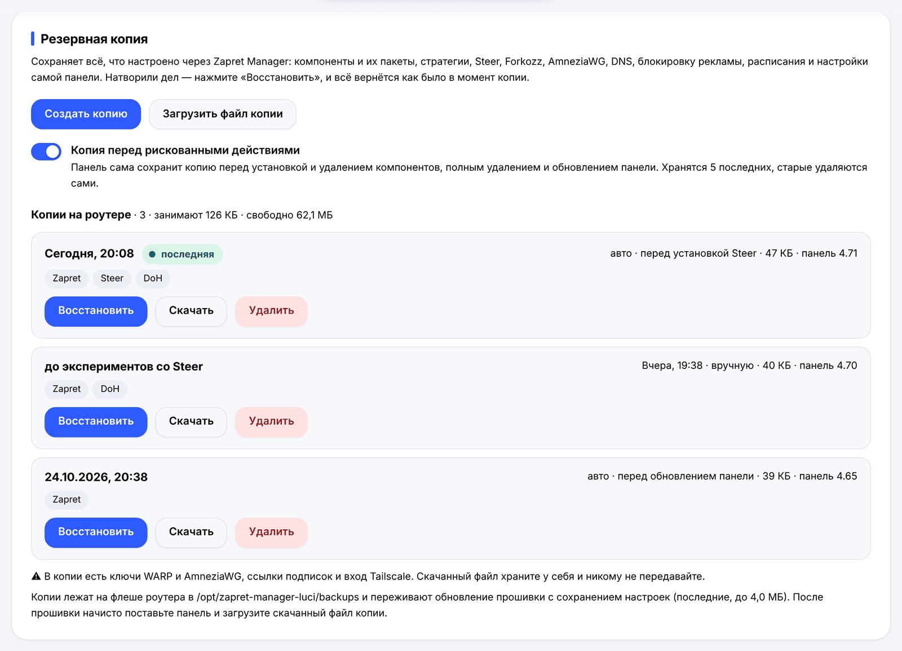</a><br>
  <sub>Список копий на роутере: автоматические (перед установкой или обновлением) и ваши, с названием. У каждой — что в неё попало.</sub>
</p>

- **Что сохраняется:** всё, что настроено через Zapret Manager — компоненты и список их пакетов с версиями, стратегии, Steer, Forkozz, AmneziaWG, DNS, блокировка рекламы, расписания, настройки самой панели, а также сеть, firewall, DHCP и hosts — целиком, как они есть сейчас. Wi-Fi, пароль роутера и остальные настройки OpenWrt не трогаются.
- **«Создать копию»** — занимает несколько секунд и ничего не перезапускает. Можно дать название, например «до экспериментов со Steer».
- **Копия перед рискованными действиями** (включено по умолчанию) — панель **сама** сохраняет копию перед установкой и удалением компонентов, полным удалением и обновлением панели. Хранятся 5 последних таких копий, старые удаляются сами.
- **«Восстановить»** — перед восстановлением панель покажет, **что именно изменится** и что может отличаться (другая версия панели или прошивки, копия с другого роутера, программы скачаются свежих версий). Для подстраховки текущее состояние тоже сохранится — передумаете, вернёте одной кнопкой. Если после смены сети роутер потеряет интернет, прежняя сеть **вернётся сама через 90 секунд**.
- **«Скачать»** и **«Загрузить файл копии»** (`.zmb`) — храните копию на компьютере. Копии на роутере переживают обновление прошивки с сохранением настроек; после прошивки «начисто» поставьте панель и загрузите скачанный файл.

> [!WARNING]
> В копии есть **ключи WARP и AmneziaWG, ссылки подписок и вход Tailscale**. Скачанный файл храните у себя и **никому не передавайте**.

#### Очистка и удаление

- **«Очистить мусор»** — журналы операций, результаты тестов, недокачанные архивы, кэш списков и остатки прошлых версий. Настройки, программы и нужные списки не трогает. *Зачем:* освободить флеш.
- **«Удалить панель»** — только приложение в LuCI и Web UI. Zapret, Steer, Forkozz и всё остальное останутся и продолжат работать. Настройки панели можно сохранить.
- **«Полное удаление»** — всё, что ставила панель: программы, пакеты, файлы, настройки, правила и задания — **вместе с хвостами**, даже если программа уже удалена. Сначала панель проверит роутер и покажет, что найдено (по группам: обход блокировок, VPN и прокси, DNS и сеть, инструменты, сама панель); отметьте нужное и для подтверждения введите слово **`УДАЛИТЬ`**. Сеть, Wi-Fi и пакеты OpenWrt не трогаются.

---

## 🧭 Какой инструмент выбрать

**Правило простое:** начинайте с **Zapret** — он бесплатный, быстрый и решает большинство задач. Остальное добавляйте, только если что-то не заработало.

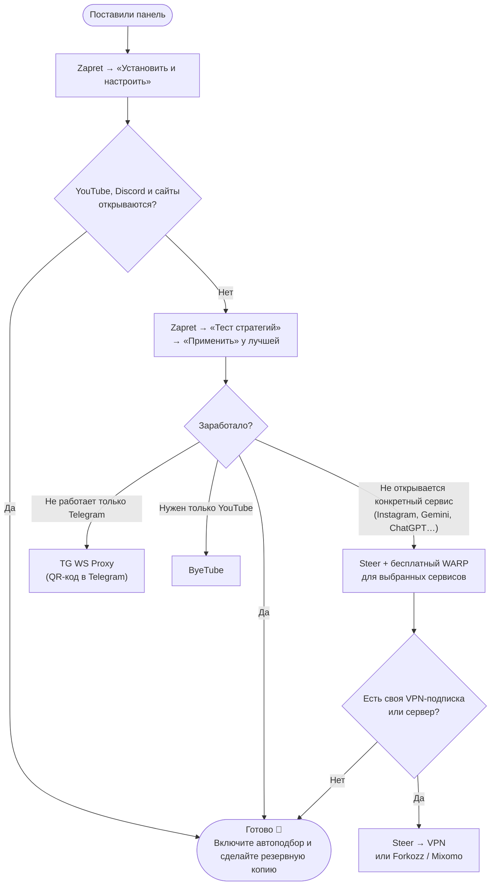

| Ваша задача | Что поставить | Почему |
|---|---|---|
| Чтобы просто работали YouTube, Discord и заблокированные сайты | **Zapret** | Бесплатно, без серверов, без потери скорости. |
| Zapret не помогает, а роутер на aarch64_cortex-a53 | **Zapret2** | Другой движок. |
| Нужен только YouTube | **ByeTube** | Самый лёгкий вариант, остальное не затрагивается. |
| Сайт не открывается даже с Zapret (Instagram, Gemini и т.п.) | **Steer** | Бесплатный WARP настраивается сам, через него идут только нужные сервисы. |
| Есть VPN-подписка, хочу пускать через неё только нужные сайты | **Steer** (Подключение → VPN) или **Mixomo** | Steer — проще, Mixomo — с наглядной веб-панелью серверов. |
| Разные сервисы через разные пути (видео через VPN, нейросети через WARP) | **Steer** (секции) или **Forkozz** | Steer — до 6 секций, проще; Forkozz — до 9, больше тонких настроек. |
| Плохо работает Telegram | **TG WS Proxy** | Подключается в Telegram по QR-коду, без VPN. |
| Надоела реклама | **Блокировка рекламы** | Один раз на роутере — для всех устройств. |
| Не хочу, чтобы провайдер видел и подменял DNS | **DNS over HTTPS** | Шифрованный DNS для всей сети. |
| Есть свой сервер WireGuard / AmneziaWG | **AmneziaWG** | Управление туннелями. |
| Роутер тормозит — хочу понять почему | **Монитор ресурсов** | Видно, что занимает процессор и память. |
| Хочу обход на телефоне и вне дома | **Удалённый доступ** | Телефон выходит в интернет через домашний роутер (для опытных). |
| Хочу экспериментировать без страха | **Резервная копия** (в «Системе») | Одна кнопка — и всё как было. |
| Хочу всё убрать начисто | **Полное удаление** (в «Системе») | Удалит всё, что ставила панель, вместе с хвостами. |

---

## ❓ Частые проблемы

<details>
<summary><b>Поставил Zapret, а сайт / YouTube всё равно не открывается</b></summary>

1. Убедитесь, что Zapret **запущен** (зелёная точка на Дашборде).
2. Примените подсказки-баннеры на Дашборде, если они есть (особенно про **Flow Offloading** и **IPv6**).
3. Запустите **тест стратегий** в Zapret и примените лучшую. Для YouTube — отдельный тест YouTube.
4. На компьютере включите **TCP timestamps** (см. [Установку](#-установка)).
5. Очистите кэш браузера или откройте сайт в режиме «инкогнито».
6. Если ничего не помогает — сайт, скорее всего, заблокирован так, что «переодевание» бессильно. Поставьте **Steer**.

</details>

<details>
<summary><b>После установки компонента пропал интернет</b></summary>

Нажмите **«Остановить»** (или «Удалить») у последнего поставленного компонента и проверьте, вернулся ли интернет. Удаление в панели полное — правила убираются, сеть возвращается в исходное состояние. Если не помогло — перезагрузите роутер.

Самый надёжный способ — **Система → Резервная копия панели → «Восстановить»**: панель сама сохраняет копию перед каждой установкой, так что можно вернуться к состоянию «до».

</details>

<details>
<summary><b>Интернет есть, но сайты не открываются ни на одном устройстве</b></summary>

*Почему:* чаще всего перестал отвечать сервер **DNS over HTTPS** — роутер не может узнать адреса сайтов. Дашборд в таком случае сам покажет предупреждение.

1. Откройте **DNS over HTTPS** → нажмите **«Проверить»** и выберите отвечающий сервер (или «Подобрать автоматически»).
2. Включите **«Переключать на запасной сервер»** — чтобы в следующий раз роутер переключился сам.
3. Если провайдер обрывает соединения с DoH — включите **«Обход блокировки DoH»** в Zapret → Стратегии → Дополнения к стратегии.
4. Если DNS не трогали — перезагрузите роутер.

</details>

<details>
<summary><b>Панель выглядит «сломанной», кнопки не работают, страница пустая или старая — почистите кэш браузера</b></summary>

*Почему:* браузер запоминает файлы страниц, чтобы открывать их быстрее. После обновления панели он может показывать **старые** файлы вперемешку с новыми — отсюда кривое оформление, пустые разделы, неработающие кнопки, ошибки вроде «метод не найден». Панель старается сбросить кэш сама, но иногда браузер упрямится.

**Что сделать — от простого к надёжному:**

1. **Жёсткое обновление страницы** (перезагрузка без кэша):
   - Windows / Linux: **`Ctrl + F5`** или **`Ctrl + Shift + R`**;
   - macOS: **`Cmd + Shift + R`**.
2. **Открыть в режиме «Инкогнито»** (`Ctrl + Shift + N` в Chrome/Edge, `Ctrl + Shift + P` в Firefox). Если там всё нормально — дело точно в кэше.
3. **Очистить кэш браузера:**
   - Chrome / Edge / Яндекс: нажмите **`Ctrl + Shift + Delete`** → период **«Всё время»** → отметьте **«Изображения и другие файлы, сохранённые в кэше»** → **«Удалить данные»**;
   - Firefox: **`Ctrl + Shift + Delete`** → **«Кэш»** → **«Удалить»**;
   - Safari (Mac): меню **Safari → Настройки → Дополнения** → включить «Показывать меню Разработка», затем **Разработка → Очистить кэши**.
4. **На телефоне:**
   - Android (Chrome): **⋮ → История → Удалить данные** → «Изображения и файлы в кэше»;
   - iPhone (Safari): **Настройки → Safari → Очистить историю и данные**.

После очистки откройте панель заново и войдите. Пароли и настройки на роутере от этого **не пропадают** — чистится только память браузера.

</details>

<details>
<summary><b>Установщик .bat не находит роутер или не подключается</b></summary>

- Проверьте, что компьютер подключён **к этому роутеру** (не к мобильному интернету и не через VPN — **выключите VPN на компьютере** на время установки).
- Если установщик спросит адрес — введите адрес роутера (обычно `192.168.1.1`; он должен открываться в браузере).
- Если файл исчез сразу после скачивания или не запускается — его удалил антивирус, см. предупреждение в разделе [Установка](#-установка).
- Не получается — используйте **Способ 2 (через SSH)**: результат тот же.

</details>

<details>
<summary><b>Не получается подключиться по SSH</b></summary>

- Проверьте адрес роутера (обычно `192.168.1.1`) — он должен открываться в браузере.
- Логин — **`root`**, пароль — от LuCI. Пароль при вводе **не виден** — это нормально.
- Если пароль на роутере не задан, задайте его в LuCI: **Система → Администрирование**.
- Ошибка `REMOTE HOST IDENTIFICATION HAS CHANGED` (после перепрошивки роутера) — выполните на компьютере `ssh-keygen -R 192.168.1.1` и подключитесь снова.

</details>

<details>
<summary><b>Страница пишет «Object not found» / «метод не найден»</b></summary>

*Почему:* служба роутера ещё не подхватила панель, или браузер показывает старые файлы. Сначала [почистите кэш браузера](#-частые-проблемы) и обновите страницу. Если не помогло — подождите пару минут, **сторож** исправит это сам. Или выполните в SSH:

```sh
/etc/init.d/rpcd restart
```

</details>

<details>
<summary><b>Web UI не открывается на порту 7788</b></summary>

*Почему:* не запущен отдельный веб-сервер или не хватает пакета `uhttpd-mod-ubus` (установщик ставит его сам, но мог не скачать). Проверьте в SSH:

```sh
uci show uhttpd.zmweb
/etc/init.d/uhttpd restart
```

Или просто переустановите панель командой **`zmw`**. Помните: Web UI открывается **только из домашней сети**. Панель всегда доступна и через LuCI: **Службы → Zapret Manager**.

</details>

<details>
<summary><b>Через Steer / Forkozz сайт всё равно идёт напрямую</b></summary>

*Почему:* устройство спрашивает адреса сайтов не у роутера, а напрямую — и роутер «не узнаёт», что это нужный сайт.

1. Проверьте сайт в **«Куда пойдёт запрос»**.
2. Отключите на телефоне **«Частный DNS»** (Android: Настройки → Сеть → Частный DNS → Выкл.) и **«Безопасный DNS»** в браузере (Chrome, Edge, Firefox) — они идут мимо роутера.
3. Очистите кэш или перезапустите браузер — устройство могло запомнить старый адрес.

</details>

<details>
<summary><b>Steer пишет, что туннель WARP «в российском узле»</b></summary>

*Почему:* Cloudflare подключил туннель через свой сервер в России (например, Домодедово) — через него заблокированное не откроется. Steer такие туннели в работу не берёт.

Нажмите **«Подобрать точку входа»** / **«Сменить точки входа»** — или включите **автопочинку** (на вкладке AmneziaWG) / **автоподбор мёртвых туннелей** (в Steer): они уводят туннели на зарубежные узлы сами.

</details>

<details>
<summary><b>Удалённый доступ: телефон подключился, но обход или домашняя сеть не работают</b></summary>

1. Проверьте, что роутер **одобрен на сервере**: отмечены домашняя подсеть и Exit Node. Статус на странице «Удалённый доступ» должен быть без «ждёт одобрения».
2. Проверьте, что в панели сервера **DNS указан адрес роутера**, а MagicDNS выключен — без этого не работают Steer, Forkozz и блокировка рекламы.
3. На телефоне выберите роутер как **Exit Node** и включите приём маршрутов. В TailSocks часть нужных настроек выключена по умолчанию — панель перечисляет, какие включить.
4. Роутера нет в списке Exit Node — подождите минуту и откройте список снова.
5. Нажмите **«Применить настройки заново»** на странице «Удалённый доступ».

</details>

<details>
<summary><b>Модуль AmneziaWG не загружается</b></summary>

*Почему:* готовые модули собраны под **официальные** прошивки OpenWrt. На сторонних сборках ядро может отличаться — нужна официальная прошивка той же версии. Причину панель пишет в журнале установки.

</details>

<details>
<summary><b>После включения блокировки рекламы перестал открываться сайт или ссылка</b></summary>

*Почему:* сайт попал в список блокировки.

1. Впишите домен в **«Проверить домен»** — панель покажет, блокируется ли он, и разблокирует одной кнопкой. Или добавьте его в **белый список** вручную.
2. Если проблема только на одном устройстве (например, ТВ-приставка, IPTV) — добавьте его в **«Устройства без блокировки»**.
3. Если не открывается вообще ничего — нажмите **«Выключить»** и проверьте: чаще причина в интернете, а не в списке.
4. На роутере с малым объёмом памяти выберите список полегче (Light).
5. Если на телефоне пропал интернет после включения «Не давать устройствам обходить блокировку» — выключите на нём «Частный DNS».

</details>

<details>
<summary><b>Роутер стал тормозить</b></summary>

Откройте **Монитор ресурсов**: в блоке «Кто сколько занимает» видно, какой компонент нагружает процессор или память. Частые причины: слишком строгий список рекламы на роутере с малой памятью, расширенный sing-box, несколько одновременно работающих тяжёлых компонентов. Отключите лишнее или выберите облегчённые варианты.

</details>

<details>
<summary><b>Терминал не открывается во встроенном окне</b></summary>

*Почему:* панель открыта по `https`, а терминал работает по `http` — браузер не разрешает их смешивать. Нажмите **«Открыть в новой вкладке»**. Терминал доступен только из домашней сети.

</details>

<details>
<summary><b>Ничего не помогло</b></summary>

Зайдите в **Система → Системная информация**, нажмите **«Скопировать отчёт»** и напишите в [Telegram-сообщество](https://t.me/stressozz_manager), приложив отчёт и описав проблему. Так вам помогут гораздо быстрее.

</details>

---

## 💬 Вопросы новичков

<details>
<summary><b>Это платно?</b></summary>

Нет. Zapret Manager бесплатный, как и Zapret, ByeTube, WARP, прокси для Telegram и блокировка рекламы. Платить придётся, только если вы сами решите подключить платную VPN-подписку — это необязательно.

</details>

<details>
<summary><b>У меня обычный роутер (Keenetic, TP-Link, Asus, роутер от провайдера…) — подойдёт?</b></summary>

Только если на нём стоит прошивка **OpenWrt**. На заводской прошивке панель работать не будет. Многие роутеры можно перепрошить на OpenWrt — поддерживается ли ваша модель, можно проверить в [списке устройств OpenWrt](https://openwrt.org/toh/start). Нужен обход только на компьютере с Windows — используйте **[ZapretOzz](https://github.com/StressOzz/ZapretOzz)**.

</details>

<details>
<summary><b>Нужно ли что-то ставить на телефоны, компьютеры, телевизор?</b></summary>

Нет — всё делает роутер. Две небольшие оговорки:
- прокси для Telegram нужно один раз добавить в сам Telegram (по ссылке или QR-коду из панели);
- если включаете Steer / Forkozz, на телефонах лучше выключить «Частный DNS» (см. [Частые проблемы](#-частые-проблемы)).

</details>

<details>
<summary><b>Интернет станет медленнее?</b></summary>

**Zapret, Zapret2 и ByeTube** — нет: трафик идёт напрямую, как обычно. **Steer, Forkozz, Mixomo** пускают через туннель **только выбранные сайты**, а остальное — напрямую; скорость этих сайтов зависит от сервера туннеля.

</details>

<details>
<summary><b>Нужно ли держать компьютер включённым? Что будет после перезагрузки роутера?</b></summary>

Компьютер нужен только для установки. Всё работает на роутере и **само запускается** после его перезагрузки или отключения света.

</details>

<details>
<summary><b>Перестали работать банк, госуслуги или какой-то российский сайт</b></summary>

Добавьте сайт в **исключения**: в Zapret — список «Исключения», в Forkozz — вкладка «Исключения». Такие сайты будут открываться как обычно, без обхода.

</details>

<details>
<summary><b>Можно ли что-то сломать?</b></summary>

Сломать роутер панелью очень трудно: прошивку она не трогает, а каждый компонент можно остановить или полностью удалить одной кнопкой. Опасные изменения (список рекламы, конфигурация Mihomo, sing-box, DNS) **проверяются заранее и откатываются сами**, если что-то пошло не так. А перед установкой, удалением и обновлением панель сама делает **резервную копию** — запутались, нажмите в **Система → Резервная копия панели** «Восстановить», и всё вернётся как было.

</details>

<details>
<summary><b>Как обновлять? Пропадут ли настройки?</b></summary>

Когда выйдет новая версия, на Дашборде появится баннер — нажмите **«Обновить панель»**. Настройки всех компонентов сохраняются, а перед обновлением панель сама сделает резервную копию. После обновления, если страница выглядит странно, [почистите кэш браузера](#-частые-проблемы).

</details>

<details>
<summary><b>Будет ли обход работать на телефоне вне дома?</b></summary>

Сам по себе — нет: обход работает на роутере, то есть дома. Но если настроить **[Удалённый доступ](#-удалённый-доступ-tailscale)**, телефон в мобильном интернете или в чужом Wi-Fi будет выходить в интернет через домашний роутер — и обход заработает, как дома. Настройка требует немного разобраться (сервер, одобрение роутера, приложение на телефоне), панель ведёт по шагам.

</details>

<details>
<summary><b>Хочу переставить прошивку или сменить роутер — придётся всё настраивать заново?</b></summary>

Нет. Сделайте **резервную копию** и **скачайте её на компьютер** (Система → Резервная копия панели → «Скачать»). После прошивки поставьте панель и нажмите «Загрузить файл копии» → «Восстановить». Если копия с другого роутера, панель честно покажет, что может отличаться (например, туннели WARP придётся пересоздать).

</details>

<details>
<summary><b>Роутер что-то делает в фоне — можно это выключить?</b></summary>

Да: **Система → Фоновые проверки** — выключите «Проверять в фоне». Тогда роутер сам ничего не проверяет и не чинит (только по кнопке). А в **Система → Поиск новых версий** можно выбрать «только кнопкой» — роутер не будет сам ходить в интернет за обновлениями.

</details>

<details>
<summary><b>Можно ли управлять с телефона?</b></summary>

Да. Откройте `http://192.168.1.1:7788` в браузере телефона, подключённого к домашнему Wi-Fi. Панель подстраивается под маленький экран.

</details>

---

## 🔗 Совместимость компонентов

> **Простыми словами:** некоторые инструменты делают одну и ту же работу с одним и тем же трафиком. Если поставить их вместе, они будут «драться», и не заработает ни один. Поэтому панель **не даст** поставить несовместимое и объяснит почему.

| Компонент | Не ставится вместе с |
|---|---|
| **Zapret** | Zapret2 |
| **Zapret2** | Zapret |
| **Steer** | Forkozz, NetShift, splify2, чужая настройка ядра steer |
| **Forkozz** | Steer, Mixomo, DoH, Podkop, PassWall, NextDNS |
| **Mixomo** | Forkozz, NetShift, ByeTube |
| **ByeTube** | Mixomo |
| **DoH** | Forkozz |

Zapret совместим со всеми туннельными инструментами (Steer, Forkozz, Mixomo) — их можно использовать вместе. Steer и ByeTube тоже могут работать параллельно — панель напомнит пускать YouTube только через что-то одно. **Steer и DNS over HTTPS** работают вместе (перехват DNS в режиме «Авто»). **Удалённый доступ** совместим со всем: телефон через Tailscale обслуживают Zapret, Steer, Forkozz, sTGWS и блокировка рекламы.

---

## 🛠️ Техническая документация (для продвинутых)

*Раздел для тех, кому интересно, что происходит «под капотом»: администраторов, разработчиков и тех, кто хочет разобраться в проблеме сам. Для обычной работы читать не обязательно — всё это панель делает за вас.*

> [!NOTE]
> Описание соответствует версии **4.71**. Пути, имена методов и расписания взяты из установщика `ZapretManager_LuCI.sh` этой версии. В новых версиях детали могут меняться.

### Архитектура

Панель — это **один shell-скрипт-установщик** (`ZapretManager_LuCI.sh`). Он раскладывает по роутеру бэкенд, rpcd-плагин, ACL, страницы LuCI и отдельный Web UI, а затем настраивает второй экземпляр веб-сервера `uhttpd`. Никаких демонов панель не держит: вся логика — это вызовы `backend.sh` по запросу из браузера или по расписанию cron.

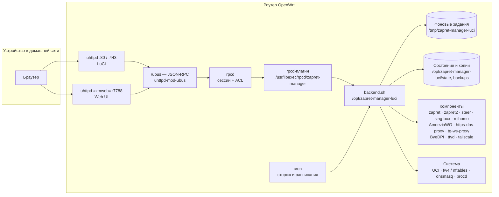

| Слой | Где | Что делает |
|---|---|---|
| **Страницы LuCI** | `/www/luci-static/resources/view/zapret-manager/*.js`, общий модуль `…/zapret-manager/common.js`, стили `…/view/zapret-manager/style.css` | 16 страниц-модулей LuCI (`view.extend`). Меню — `/usr/share/luci/menu.d/luci-app-zapret-manager.json` (**Службы → Zapret Manager**). |
| **Web UI** | `/www/zm-webui.html`, `/www/zm/app.js`, `/www/zm/app.css` | Отдельная «оболочка», которая грузит **те же** JS-модули страниц, что и LuCI (см. [Web UI изнутри](#web-ui-изнутри)). |
| **Транспорт** | `uhttpd` + `uhttpd-mod-ubus`, путь `/ubus` | JSON-RPC 2.0 поверх HTTP: `call(sid, object, method, params)`. |
| **Авторизация** | `rpcd` (сессии), `/usr/share/rpcd/acl.d/luci-app-zapret-manager.json` | Логин — стандартный `session.login` (пользователь и пароль роутера). ACL решает, какие методы доступны сессии. |
| **Плагин** | `/usr/libexec/rpcd/zapret-manager` (shell, `jshn`) | Регистрирует объект ubus `zapret-manager`, разбирает параметры и вызывает `backend.sh <метод> <аргументы>`. |
| **Бэкенд** | `/opt/zapret-manager-luci/backend.sh` (+ ucode-модуль Forkozz `netshift.uc`, base64-хелпер `b64.uc`) | Вся логика: установка, настройка, тесты, расписания, диагностика. Отвечает JSON. |
| **Каталог сервисов** | `/usr/share/zm-redbtn/services.conf`, `/usr/share/zm-redbtn/svc/*.lst` | Встроенный список сервисов Steer/Forkozz (YouTube, Discord, Meta, …) и дополнительные домены к ним. |

### Web UI изнутри

- **Отдельный экземпляр `uhttpd`** с именем секции `zmweb`. Установщик создаёт его так (если секции ещё нет):

  ```sh
  uci set uhttpd.zmweb=uhttpd
  uci add_list uhttpd.zmweb.listen_http='0.0.0.0:7788'
  uci add_list uhttpd.zmweb.listen_http='[::]:7788'
  uci set uhttpd.zmweb.home='/www'
  uci set uhttpd.zmweb.index_page='zm-webui.html'
  uci set uhttpd.zmweb.ubus_prefix='/ubus'
  uci set uhttpd.zmweb.no_dirlists='1'
  uci set uhttpd.zmweb.rfc1918_filter='1'
  uci set uhttpd.zmweb.max_requests='12'
  uci set uhttpd.zmweb.script_timeout='120'
  uci commit uhttpd && /etc/init.d/uhttpd restart
  ```

  Порт можно поменять в `uhttpd.zmweb.listen_http`: установщик при обновлении секцию не перезаписывает и в конце печатает фактический порт.
- **Тонкая прослойка вместо LuCI.** `app.js` реализует минимальный набор API LuCI, на который опираются страницы: `L`, `E()`, `baseclass`, `view`, `rpc.declare`, `uci`, `fs`, `ui`. Модуль страницы (`/luci-static/resources/view/zapret-manager/<страница>.js`) скачивается и исполняется как есть — поэтому LuCI и Web UI всегда умеют одно и то же.
- **Маршрутизация** — через `#/<id>`: `#/dashboard`, `#/strategy`, `#/steer`, `#/forkozz`, `#/adblock`, `#/doh`, `#/monitor`, `#/system`, `#/backup` и т.д. Подразделы «Системы» (`#/watch`, `#/cleanup`, `#/sysinfo`, `#/backup`) — это та же страница `system.js`, показанная по частям.
- **Сессия.** Вход — `session.login` с `timeout: 3600`. Идентификатор сессии (`ubus_rpc_session`) хранится в `sessionStorage`, а с галочкой «Запомнить на этом устройстве» — в `localStorage`. Перед тем как выкинуть на экран входа, панель проверяет сессию через `session.access` (с повтором), чтобы короткий сбой rpcd не разлогинивал.
- **Устойчивость.** Таймаут запроса — 60 с. Ответ `Object not found` (rpcd ещё перечитывает плагины после обновления) повторяется до 6 раз с паузой 1,5 с. На `/ubus` → `404` панель прямо пишет, что не хватает `uhttpd-mod-ubus`.
- **Пакетные запросы.** Чтобы страница открывалась быстро, несколько «читающих» вызовов склеиваются в один `multi` (подробно — ниже).
- **Тема и меню хранятся на роутере**: тема — `/www/zm/theme.txt` (копия — `state/ui.theme`, переживает переустановку), скрытые разделы меню — в состоянии панели. Поэтому они одинаковы на всех устройствах. В браузере остаются только мелочи вроде последней открытой вкладки.
- **Сброс кэша после обновления.** Установщик подставляет вместо `__ZMW_BUILD__` метку времени сборки в ссылки на `app.js`/`app.css` (`?v=<timestamp>`), поэтому браузер получает новые файлы.

### API: объект ubus `zapret-manager`

Всё, что умеет панель, доступно как методы ubus — из браузера, из SSH и из ваших скриптов. Всего в плагине **больше 120 методов**. Посмотреть полный список с параметрами:

```sh
ubus -v list zapret-manager
```

Методы делятся на «читающие» (статусы, списки, журналы — без побочных эффектов) и «действующие» (установка, применение, удаление). В ACL читающим выдано право `read` (≈50 методов), действующим — `write` (≈80 методов).

<details>
<summary><b>Самые полезные методы</b></summary>

| Метод | Параметры | Что возвращает / делает |
|---|---|---|
| `status` | — | Состояние Zapret/Zapret2: установлен, запущен, версия, текущая стратегия, флаги дополнений, идёт ли тест. |
| `health` | — | Сводка «светофора» для всех компонентов: `dots` (0 — не установлен, 1 — работает, 2 — ошибка, 3 — частично, 4 — выключен), плюс предупреждения (`flow_warn`, `ipv6_warn`, `reboot_hint`…). |
| `system_info` | — | Модель, архитектура, платформа, версия OpenWrt, ядро, флеш и `/tmp`, температура и загрузка ЦП, есть ли интернет и пинг. |
| `system_status` | — | QUIC, IPv6 в Zapret, режим Flow Offloading и поправки к нему, время и часовой пояс роутера. |
| `versions` | `action` (`''` / `refresh`) | Установленные и последние версии компонентов, расписание проверки. |
| `zm_update_status` | — | Текущая и последняя версия самой панели. |
| `steer_status`, `forkop_status`, `doh_status`, `adblock_status`, `awg_status`, `tg_status`, `tsc_status`… | — | Полное состояние соответствующего раздела. |
| `zapret_action` | `action`: `install` / `update` / `remove` / `start` / `restart` … | Управление Zapret. Долгие действия запускаются фоновым заданием. |
| `job_status`, `log_tail` | `job` | Состояние и журнал фонового задания. |
| `backup_list`, `backup_action` | `action`, `value` | Список резервных копий; создание, восстановление, удаление. |
| `monitor`, `monitor_procs` | — | Срез `/proc` для Монитора ресурсов: ЦП по ядрам, память, сеть, датчики, процессы. |
| `multi` | `calls` | Пакетный вызов нескольких читающих методов (ниже). |

Примеры из SSH:

```sh
ubus call zapret-manager health
ubus call zapret-manager status
ubus call zapret-manager system_info
ubus call zapret-manager versions '{"action":"refresh"}'
```

Бэкенд можно вызывать и напрямую, без ubus, — ответ будет тем же JSON:

```sh
/opt/zapret-manager-luci/backend.sh health
```

</details>

<details>
<summary><b>Пакетный вызов <code>multi</code></b></summary>

Web UI при открытии страницы делает много «читающих» запросов. Чтобы не гонять их по одному, клиент собирает их в очередь и отправляет одним вызовом:

```sh
ubus call zapret-manager multi '{"calls":"status\nsystem_status\ndoh_status"}'
# → {"r":[ {…status…}, {…system_status…}, {…doh_status…} ]}
```

- `calls` — строки `метод` или `метод<TAB>аргумент`, по одной на строку.
- В пакет попадают только безопасные методы: `status`, `health`, `versions`, `zm_update_status`, `lan_ip`, `bytetube_installed`, `*_status`, `*_get`, `strategy_list_*`, `mixomo_proxies`. Аргумент — не длиннее 64 символов из `[A-Za-z0-9_.:@-]`.
- На сервере вызовы выполняются **параллельно**, не больше 16 за раз; клиент шлёт пачки по 12.
- Если какой-то ответ не получился, на его месте будет `{"__fail":true}`, и клиент повторит этот вызов отдельно. Если `multi` недоступен (старая версия плагина, нет прав), клиент сам переходит на одиночные вызовы.

</details>

### Фоновые задания

Установка, удаление, тесты стратегий и другие долгие операции **не выполняются внутри HTTP-запроса** — иначе закрытая вкладка или оборвавшийся Wi-Fi прервали бы их на полпути. Вместо этого бэкенд запускает фоновое задание и сразу отвечает `{"started":true,"job":"<имя>"}`.

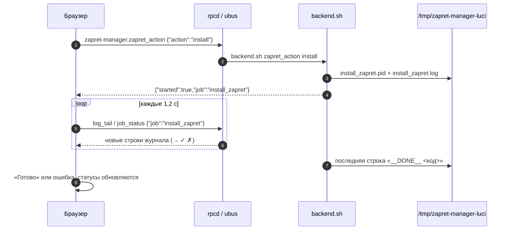

- Журнал — `/tmp/zapret-manager-luci/<задание>.log`, PID — рядом в `<задание>.pid`. Последняя строка журнала — `__DONE__ <код выхода>`; код `130` означает «остановлено пользователем».
- Перед рискованным заданием автоматически делается [резервная копия](#-резервная-копия-панели) (если это не выключено), после него — проверка и восстановление сети.
- Шаги с сетью и установкой пакетов ограничены по времени. Если DNS роутера не отвечает, на время операции подставляются `1.1.1.1` и `9.9.9.9`, потом прежний DNS возвращается.
- Если журнал не меняется дольше 2 минут, в окне вывода появляется кнопка **«Остановить все операции»**: она завершает задания и откатывает незаконченное (например, возвращает прежнюю версию Forkozz).
- Пока идёт операция, установщик панели и самообновление не стартуют — они проверяют `*.pid` в этой папке.

### Расписания (cron)

Все задания панели лежат в `/etc/crontabs/root` и помечены комментарием `# zm-…`, поэтому их легко найти и панель удаляет их без остатка:

```sh
grep '# zm-' /etc/crontabs/root
```

| Метка | Когда | Что делает |
|---|---|---|
| `# zm-rpcd-watch` | каждые 2 мин | **Сторож** (`backend.sh zm_watch`, подробнее — ниже). Не ставится, если фоновые проверки выключены в «Системе». |
| `# zm-versions` | по выбору (по умолчанию раз в сутки ночью) | Поиск новых версий; при включённом автообновлении — тихое обновление. |
| `# zm-autobest` | ежедневно в выбранное время | Автоподбор стратегии Zapret (`test_action auto_tick`). |
| `# zm-excl-auto` | раз в 2 / 4 / 6 / 12 ч | Обновление списка исключений Zapret. |
| `# zm-dohwatch` | каждые 2 мин | Переключение DNS over HTTPS на запасной сервер и обратно. |
| `# zm-adblock`, `# zm-abstats` | ежедневно / периодически | Обновление списков рекламы и сбор статистики. |
| `# zm-steer` | по выбору | Автоперезапуск Steer и туннелей. |
| `# zm-wfix` | каждые 10 мин | Автоподбор «мёртвых» туннелей WARP в Steer. |
| `# zm-subupd`, `# zm-subping` | по выбору | Обновление подписок VPN и автовыбор сервера по пингу в Steer. |
| `# zm-awgfix` | каждые 10 мин | Автопочинка туннелей WARP на вкладке AmneziaWG. |
| `# zm-tg-auto-<прокси>` | раз в 1–12 ч | Автоперезапуск выбранного TG WS Proxy. |
| `# zm-tailscale` | каждую минуту | Сторож Удалённого доступа: возвращает настройки Tailscale на место. |
| `# zm-autoclean` | по выбору | Автоматическая «Очистка мусора». |

Расписания появляются только для включённых функций. После переустановки панели пользовательские расписания восстанавливаются из `state/cron.saved`.

<details>
<summary><b>Что делает сторож (каждые 2 минуты)</b></summary>

«Дежурный», который сам чинит типичные поломки. Если чинить нечего, выходит сразу и почти не нагружает роутер.

- поднимает службу **rpcd**, если она упала или зависла (иначе пропадает вход в LuCI и Web UI);
- возвращает DNS роутера, если операция прервалась на полпути;
- перезапускает **Forkozz**, если он включён, но не работает (с нарастающей паузой, чтобы не зациклиться), чинит мёртвые серверы и переключает DNS;
- проверяет и чинит **VPN в Steer** и в его секциях;
- следит, чтобы туннели WARP не уходили на **российские узлы** Cloudflare;
- поднимает упавшие **TG WS Proxy**;
- возвращает **список блокировки рекламы** после перезагрузки (список живёт в ОЗУ);
- обновляет адреса DNS провайдера для российских сайтов, если провайдер их сменил;
- переводит ядро steer 1.x на 2.x.

Сторожа можно выключить в **Система → Фоновые проверки** (появится файл `state/watch.off`, и установщик при обновлении не вернёт задание в cron). У **Удалённого доступа** свой сторож — раз в минуту.

</details>

### Файлы и каталоги

| Путь | Что это |
|---|---|
| `/opt/zapret-manager-luci/backend.sh` | бэкенд: вся логика панели; версия — в строке `ZM_VERSION=` |
| `/opt/zapret-manager-luci/netshift.uc`, `b64.uc` | ucode-модуль Forkozz; кодирование base64 для скачивания копий |
| `/opt/zapret-manager-luci/state/` | состояние панели: тема (`ui.theme`), флаги подсказок (`ui.flags`), кэш версий (`versions.json`, `latest.*`), автоподбор, `watch.off`, `cron.saved` и т.д. |
| `/opt/zapret-manager-luci/state/adblock/` | настройки, белый и чёрный список, скачанные списки блокировки рекламы |
| `/opt/zapret-manager-luci/backups/` | резервные копии панели (`*.zmb`) |
| `/usr/libexec/rpcd/zapret-manager` | rpcd-плагин — объект `zapret-manager` в ubus |
| `/usr/share/rpcd/acl.d/luci-app-zapret-manager.json` | права доступа (ACL) |
| `/usr/share/luci/menu.d/luci-app-zapret-manager.json` | пункт меню LuCI |
| `/www/luci-static/resources/view/zapret-manager/` | страницы (общие для LuCI и Web UI) |
| `/www/luci-static/resources/zapret-manager/common.js` | общий JS-модуль: вызовы API, тосты, журналы заданий, пакетные запросы |
| `/www/zm-webui.html`, `/www/zm/` | Web UI: оболочка, стили, `theme.txt` |
| `/usr/share/zm-redbtn/` | каталог сервисов для Steer и Forkozz |
| `/etc/zm-steer/`, `/etc/zm-awg/` | данные Steer (секции, подписки, свой WARP) и AmneziaWG (`WARP.conf`, точки входа) |
| `/etc/config/zapret` | конфигурация Zapret (блок `NFQWS_OPT` — стратегия) |
| `zm-adblock.conf` в каталоге настроек dnsmasq | собранный список блокировки (живёт в ОЗУ, после перезагрузки его возвращает сторож) |
| `/tmp/zapret-manager-luci/` | журналы и PID фоновых заданий, временные файлы |
| `/usr/bin/zms`, `/usr/bin/zmw` | запуск консольной версии и переустановка панели |
| `/etc/crontabs/root` | задания с метками `# zm-…` |

### Обновление панели

Кнопка «Обновить панель», автообновление и команда `zmw` идут одним путём:

1. С GitHub скачивается свежий `ZapretManager_LuCI.sh`. Если GitHub не отвечает напрямую, загрузка повторяется через зеркала из настройки **Система → Доступ к GitHub**.
2. Файл проверяется **до запуска**:
   - первая строка — `#!/bin/sh` (а не HTML-заглушка провайдера);
   - в файле есть строка `# Version:`;
   - в последних строках есть финальное сообщение `Web UI:` — значит, файл скачался целиком;
   - `sh -n` — синтаксис скрипта корректен.
3. Только после этого установщик запускается отдельным процессом, а панель на полминуты пропадает.
4. Установщик не начнёт работу, пока в панели идёт операция. Затем он заменяет файлы (настройки компонентов и расписания сохраняются), при необходимости включает Web UI, сверяет конфигурацию компонентов с новой версией (Forkozz, блок DoH в стратегии Zapret, скрипты ByeTube) и чистит остатки прошлых версий. Через 30 секунд сторож проверяет, что `rpcd` подхватил новый плагин.
5. При следующем входе панель показывает **«Что нового»** — список изменений берётся с GitHub, а если он недоступен — из копии, сохранённой при установке.

Версия панели записана в одном месте — строке `# Version:` в начале установщика. Отсюда она попадает в `backend.sh` (`ZM_VERSION`).

### Формат резервной копии `.zmb`

Файл копии — обычный **tar-архив** из четырёх частей:

| Файл внутри | Содержимое |
|---|---|
| `manifest` | `key=value`: `format`, `id`, `at`, `kind` (auto/manual), `name`, `reason`, `panel` (версия), `owrt`, `arch`, `board`, `host`, `lan`, `pkg` (opkg/apk), `comps` (какие компоненты), версии их пакетов (`pkgv=`), состояние служб (`svc=`), системные флаги, `sha` и `lsha` |
| `files.lst` | список сохранённых файлов с контрольными суммами |
| `cron.lst` | строки cron, принадлежащие панели |
| `files.tgz` | сами файлы конфигурации (gzip) |

- `sha` — SHA-256 архива `files.tgz`, `lsha` — SHA-256 списков. Перед восстановлением панель сверяет их, поэтому повреждённую копию восстановить не даст.
- Имя копии — `ГГГГММДД-ЧЧММСС.zmb`, хранятся в `/opt/zapret-manager-luci/backups/`. Перед созданием проверяется свободное место на флеше.
- Загрузка копии с компьютера идёт частями в base64 (до 32 МБ), скачивание — тоже частями, через `backup_down`.
- Посмотреть содержимое копии на компьютере: `tar -xf копия.zmb && cat manifest && tar -tzf files.tgz`.

> [!WARNING]
> В `files.tgz` лежат **ключи WARP и AmneziaWG, ссылки подписок и вход Tailscale** в открытом виде. Не публикуйте файл копии и не отправляйте его в чаты.

### Безопасность

- **Вход — только по паролю роутера.** Своих учётных записей у панели нет: используются сессии `rpcd`, как в LuCI. Каждый вызов проходит проверку ACL.
- **Только домашняя сеть.** Для Web UI включён `rfc1918_filter`: `uhttpd` не отвечает на запросы с публичных адресов к своему приватному адресу. Плюс стандартный firewall OpenWrt не открывает порт 7788 со стороны WAN. **Не пробрасывайте порт 7788 в интернет.** Для доступа извне используйте [Удалённый доступ](#-удалённый-доступ-tailscale).
- **Терминал (ttyd)** слушает только локальную сеть и спрашивает пароль роутера. Вкладка htop в Мониторе работает, только пока страница открыта.
- **Отчёт «Системная информация»** вычищает адреса, ключи, пароли и ссылки подписок — его можно отправлять в поддержку.
- **Опасные изменения проверяются и откатываются:** список рекламы (DNS не ответил 30 с — откат), конфигурация Mihomo и sing-box (не запустился — откат), смена зеркала OpenWrt, сеть после восстановления копии (через 90 с).
- **Источники загрузок** — GitHub авторов проектов и репозитории OpenWrt. Зеркала GitHub используются только тогда, когда GitHub не ответил (это можно выключить: Система → Доступ к GitHub → «Напрямую»).
- **`#nochange`.** Строка `#nochange` в стратегии или списке запрещает панели их менять — ни при установке, ни при обновлении, ни в тестах. Переключатели «Не изменять» ставят и снимают её сами.
- **Большие тексты** (hosts, списки, конфиги) отправляются частями, потому что веб-сервер роутера принимает не больше 64 КБ за запрос.

### Диагностика из SSH

| Задача | Команда |
|---|---|
| Сводка состояния всех компонентов | `ubus call zapret-manager health` |
| Жив ли плагин панели | `ubus -v list zapret-manager \| head` |
| Перезапустить rpcd (ошибки «Object not found» / «метод не найден») | `/etc/init.d/rpcd restart` |
| Настройки и перезапуск Web UI | `uci show uhttpd.zmweb` и `/etc/init.d/uhttpd restart` |
| Какие операции сейчас идут | `ls /tmp/zapret-manager-luci/*.pid` |
| Журнал последней операции | `tail -n 50 /tmp/zapret-manager-luci/<задание>.log` |
| Расписания панели | `grep '# zm-' /etc/crontabs/root` |
| Состояние Zapret | `/etc/init.d/zapret status` и `ps w \| grep nfqws` |
| Текущая стратегия | `grep -A30 NFQWS_OPT /etc/config/zapret` |
| Системный журнал | `logread -e zapret`, `logread -e steer`, `logread -e https-dns-proxy` |
| Резервные копии | `ls -l /opt/zapret-manager-luci/backups/` |
| Переустановить панель | `zmw` |

> [!TIP]
> Если просите помощи в [сообществе](https://t.me/stressozz_manager), начните с **Система → Системная информация → «Скопировать отчёт»** — в нём уже есть почти всё из таблицы выше.

---

## 🗑️ Удаление

- **Только панель** — «Система → Очистка и удаление → Удалить панель». Всё, что вы через неё поставили, **останется и продолжит работать**.
- **Всё сразу, начисто** — «Система → Очистка и удаление → **Полное удаление**»: программы, пакеты, файлы, настройки, правила и задания — вместе с хвостами. Для подтверждения нужно ввести слово `УДАЛИТЬ`. Сеть, Wi-Fi и пакеты OpenWrt не трогаются. Вернуть панель — команда установки или `zmw`.
- **Отдельный компонент** — кнопка «Удалить» на его странице. Удаление полное: программы, настройки, правила, задания по расписанию. После удаления панель проверяет интернет и при необходимости сама перезапускает сеть. *Зачем:* чтобы остатки не мешали работе.
- **Блокировка рекламы** — кнопка «Выключить».
- **Терминал** — кнопка «Удалить».
- **Удалённый доступ** — «Отключить роутер» (убрать из сети Tailscale) или «Удалить Tailscale» (сеть, firewall и DNS вернутся к прежнему виду).
- **Мусор** — «Система → Очистка и удаление → Очистить мусор»: журналы, результаты тестов, кэш и остатки прошлых версий. Настройки и программы не трогает.

> [!TIP]
> Перед удалением панель сама сохраняет [резервную копию](#️-система) — если передумаете, всё можно вернуть.

---

## 🤝 Благодарности

Zapret Manager собирает в одном месте работу этих проектов и их авторов:

| Проект | Автор |
|---|---|
| zapret, zapret2 | [bol-van](https://github.com/bol-van) |
| zapret-openwrt | [remittor](https://github.com/remittor/zapret-openwrt) |
| Zapret2 (пакеты), сервер удалённого доступа | [routerich](https://github.com/routerich) |
| Стратегии Flowseal | [Flowseal](https://github.com/Flowseal/zapret-discord-youtube) |
| ByeDPI-OpenWrt | [DPITrickster](https://github.com/DPITrickster/ByeDPI-OpenWrt) |
| mihomo, metacubexd, meta-rules-dat | [MetaCubeX](https://github.com/MetaCubeX) |
| zashboard | [Zephyruso](https://github.com/Zephyruso/zashboard) |
| hev-socks5-tunnel | [heiher](https://github.com/heiher/hev-socks5-tunnel) |
| MagiTrickle | [MagiTrickle](https://github.com/MagiTrickle/MagiTrickle) |
| sTGWS, Steer, каталог списков | [xyzmean](https://github.com/xyzmean) |
| steer (ядро) и релизы | [splify2](https://github.com/splify2/steer) |
| tg-ws-proxy-go (MTProto) | [spatiumstas](https://github.com/spatiumstas/tg-ws-proxy-go) |
| tg-ws-proxy-go (SOCKS5) | [d0mhate](https://github.com/d0mhate/-tg-ws-proxy-Manager-go) |
| tg-ws-proxy-rs (Rust) | [valnesfjord](https://github.com/valnesfjord/tg-ws-proxy-rs) |
| Mixomo, GeoHideDNS | [Internet-Helper](https://github.com/Internet-Helper) |
| allow-domains | [itdoginfo](https://github.com/itdoginfo) |
| zapret4rocket (список РКН) | [IndeecFOX](https://github.com/IndeecFOX/zapret4rocket) |
| NetShift (основа Forkozz) | [yandexru45](https://github.com/yandexru45/netshift) |
| sing-box | [SagerNet](https://github.com/SagerNet/sing-box) |
| sing-box-extended | [shtorm-7](https://github.com/shtorm-7/sing-box-extended) |
| ios_rule_script | [blackmatrix7](https://github.com/blackmatrix7/ios_rule_script) |
| ad-filter (список рекламы для Forkozz) | [zxc-rv](https://github.com/zxc-rv/ad-filter) |
| sing-box-supercell-ruleset | [ushan0v](https://github.com/ushan0v/sing-box-supercell-ruleset) |
| b4geoip | [DanielLavrushin](https://github.com/DanielLavrushin/b4geoip) |
| b4geoip-forkop | [Greeg0ry](https://github.com/Greeg0ry/b4geoip-forkop) |
| domain-list-community | [v2fly](https://github.com/v2fly/domain-list-community) |
| dpi-checkers | [hyperion-cs](https://github.com/hyperion-cs/dpi-checkers) |
| awg-openwrt (сборки) | [2Grey](https://github.com/2Grey/awg-openwrt) |
| dns-blocklists (списки рекламы) | [hagezi](https://github.com/hagezi/dns-blocklists) |
| ttyd (терминал) | [tsl0922](https://github.com/tsl0922/ttyd) |
| htop (диспетчер процессов) | [htop-dev](https://github.com/htop-dev/htop) |
| warpscout (разведка WARP) | [vernette](https://github.com/vernette/warpscout) |
| Tailscale | [tailscale](https://github.com/tailscale/tailscale) |
| openwrt-tailscale (сборка для OpenWrt) | [GuNanOvO](https://github.com/GuNanOvO/openwrt-tailscale) |
| luci-app-tailscale-community | [Tokisaki-Galaxy](https://github.com/Tokisaki-Galaxy/luci-app-tailscale-community) |
| TailSocks (клиент для Android) | [bropines](https://github.com/bropines/tailsocks) |
| NaïveProxy (для Forkozz) | [klzgrad](https://github.com/klzgrad/naiveproxy) |
| tg-ws-proxy (список доменов Cloudflare) | [Flowseal](https://github.com/Flowseal/tg-ws-proxy) |
| base-relay (реле регистрации WARP) | [nellimonix](https://github.com/nellimonix/base-relay) |

И **всем пользователям**, кто помогает, тестирует и поддерживает проект ❤️

---

<div align="center">

### 💬 Сообщество

Есть вопрос или что-то не получается? Пишите — помогут.

[**Telegram — Zapret Manager**](https://t.me/stressozz_manager) · [**StressKVN — обход белых списков**](http://stresskvn.lol/)

Made with ❤️ by **[StressOzz](https://github.com/StressOzz)** for the OpenWrt community

</div>
